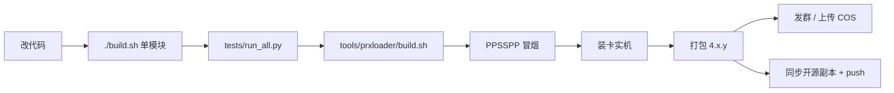

# MELODY：AI最小阅读入口

> 面向接手维护本项目的AI。先读本页，再按任务定向读代码。不要把整个工作目录、所有日志或历史发布包装进上下文。
>
> 核对日期：2026-11-11。当前源码版本 **4.1.1**，见 [src/app.h](src/app.h)。架构说明见 [PROJECT-RUNTIME.md](PROJECT-RUNTIME.md)。后续版本若变化，以代码和本轮实际构建清单为准。

## 先看改动台账：WORKLOG.md

**[WORKLOG.md](WORKLOG.md) 是本项目的改动流水。** 每次修改代码、发布包或关键文档，都在那页顶部加一条记录（改了什么、证据、验证到哪一层、下一步）。接手时先读最新一条，再回到本页按表定位文件；不要用重读整棵 `src/` 的方式「刷新上下文」。

- 最新记录：2026-11-11，省电/背光超时/时钟策略、ECO主题及中文输入法完整候选。见 [docs/POWER-SAVING-THEME.md](docs/POWER-SAVING-THEME.md) 与 [docs/IME-AND-FONTS.md](docs/IME-AND-FONTS.md)。
- 那轮留下的未闭环项：`0x80020320`（SCE_KERNEL_ERROR_MFILE，文件句柄耗尽）来源未定位；4.1.1 未在物理 PSP 上复测（打包时记忆棒不在读卡器）。

## 开源仓库（2026-11-08 起）

> 开源仓库的文档不在本工作区内：`E:\MELODY-PSP-OPENSOURCE\MELODY-PSP\docs\`（本页出现该目录路径时，指的是开源副本，不是本目录的 `docs/`）。


源码已发布：**https://github.com/XBBDYF/MELODY-PSP**（GPL-3.0）。

- 本地独立目录：`E:\MELODY-PSP-OPENSOURCE\MELODY-PSP`（独立 git 仓库，`origin` 指向 GitHub）；
- 本工作目录 `E:\MELODY_MV_20261102` 仍是**开发工作区**，不进仓库的东西都在这里（备份、发布包、日志、实验目录）；
- 同步与发布流程见 `E:\MELODY-PSP-OPENSOURCE\MELODY-PSP\docs\WORKFLOW.md`，仓库信息与分发政策见 `E:\MELODY-PSP-OPENSOURCE\MELODY-PSP\docs\GITHUB.md`；
- **安装包只在 QQ 群 1103558445 分发**，GitHub 不挂二进制、不建 Release；
- 对外文档：`docs/ARCHITECTURE.md`（架构）、`docs/LOGIC.md`（运行逻辑）、`docs/SCREENSHOTS.md`（截图）、
  `docs/BUILD.md`（构建）、`docs/THEMES.md`（皮肤）、`CHANGELOG.md`、`CREDITS.md`、`THIRD-PARTY-NOTICES.md`。
  改动这些功能时，开源副本与本文档要一起更新，别让两边描述打架。


## ## 图在哪（先看图再读代码）

维护文档里已经内嵌执行链路图，接手时按问题挑一张，别通读代码：

| 图 | 位置 | 什么时候看 |
|---|---|---|
| 启动器 → 主程序 → 线程总体关系 | `PROJECT-RUNTIME.md` §1「总体关系」 | 搞不清谁加载谁、哪些线程 |
| 开机联网与 DNS 决策 | `PROJECT-RUNTIME.md` §4.1 | 连不上网、解析超时、缓存歌能放新歌不能放 |
| 搜索（网易 + 第三方合并） | `PROJECT-RUNTIME.md` §4.2 | 搜索为空、全是翻唱、三方行排序 |
| 在线歌曲播放链路 | `PROJECT-RUNTIME.md` §5.1 | 起播慢、卡住、重试、三方音源 |
| 下载与断点续传 | `PROJECT-RUNTIME.md` §6 末尾 | 进度不对、续传、100% 未完成 |
| 皮肤加载与安装 | `PROJECT-RUNTIME.md` §7.1.1 | 主题不生效、安装失败原因 |
| MV 选源与起播门槛 | `PROJECT-RUNTIME.md` §8 | MV 卡顿、缓冲、解码模块 |
| 在线更新与更新图库 | `PROJECT-RUNTIME.md` §9 | 更新校验失败、图库不显示 |
| 开发→测试→打包→发群→同步开源 | 开源 `docs/WORKFLOW.md` | 出包、发版、同步仓库 |

对外版本（mermaid 更多、面向用户）在开源仓库：`E:\MELODY-PSP-OPENSOURCE\MELODY-PSP\README.md` 的
「运行逻辑」一节与 `docs/LOGIC.md`。




接手AI必须持续维护这两份文档

**本页与 [PROJECT-RUNTIME.md](PROJECT-RUNTIME.md)是项目维护契约，不是只读历史总结。** 修改入口、线程、路径、模块接口、数据格式、任务调度、主题模型、构建／发布或关键运行流程时，在同一任务内同步更新对应章节；新增／移动文件和测试时更新本页的定位表。

- 保持开头的核对日期、版本和状态与代码一致；版本不确定时先读 `src/app.h`，交付文件以实际manifest为准。
- 交付前逐项问：阅读路由变了吗？运行逻辑变了吗？命令／文件名仍有效吗？将答案写入交接。
- 仅修改局部内部实现、两文档事实仍成立时，可以不改正文，但必须明确说明“已核对，两份文档无需变更”及原因。
- 遇到文档与代码矛盾，先定向验证，再修文档。不要把主机或模拟器验证提升为物理PSP结论。
- 不追加长篇流水账，不全量重读代码来“刷新文档”。只维护本次变化影响的事实、链接和边界。
- 两文件之间的链接和主要文件路径须检查；若移动文档，同时更新项目入口。
- 每次修改代码后，在 [WORKLOG.md](WORKLOG.md) 顶部追加一条记录；本页只维护「阅读路由」，不承担流水账。
- 网络、视频及证据专题与本页同属维护范围；相关问题有新实测或旧结论被推翻时，同步专题的问题状态和数据来源，保留旧实验的适用范围。

> 本轮MV修订见 [4.0.1下载恢复与在线数据源记录](docs/MV-4.0.1-RECOVERY.md)：未完成任务保留、严格Range恢复、旧部分文件验证续传，以及回调路径解析。网络/视频专题应同步维护。

## 1. 先建立这七个事实

1. 这是 **PSP原生C程序＋小型启动器＋独立视频PRX＋Lua主题**，不是网页项目，也不是Godot项目。
2. 当前应用源码在 `src/`。`backups/`、`dist_*`、根目录历史源码ZIP不是现行实现。
3. 正式交付链是 `build.sh` → 根Makefile编译对象 → `tools/prxloader/build.sh`链接 `melody.prx`及启动器 →版本打包脚本。仅运行根Makefile的默认目标，不足以证明用户正在运行的那套文件已更新。
4. `APP_DIR`为 `./`。启动器从实际EBOOT位置建立目录，再传给主程序PRX；涉及PSP文件I/O的新线程要绑定自己的工作目录。不要再写死 `ms0:/PSP/GAME/MELODY/`。
5. CPU与GE/GU是**UI渲染后端**。GU五倍是此前实测结论，不代表视频解码提速五倍。
6. 缓存索引在磁盘，元数据按窗口懒加载。`CACHE_MAX=64`是窗口大小，**不是歌曲总数上限**。
7. 主线程管输入和页面；API线程管串行网络业务；下载线程管流和下载任务；音频解码与输出分线程。不要在绘制或按键处理里加入阻塞网络请求。

## 输入法热路径（实机卡顿修复）

扩展包prepare加载为高partition快照，ime_pack_read不读磁盘；按键与window查询应验证IO计数不增长。词库生命周期ime_suspend_dictionary/ime_resume_dictionary：MV前释放，非MV主循环resume无挂起时立即返回，失败只试一次。不要在键处理里重新prepare完整词库。
main search_assoc_once按key/mode/revision去重；多音节选单字只消耗首音节。tests/test_ime_performance.py覆盖实际词包、窗口与零磁盘查询。

## 单曲循环与极致列表快移

`audio_replay_current`复制当前路径、检查完整源/MV所有权，再走stop→audio_play_file新gen。正常EOF不能用audio_seek复活已退出decoder，未知时长也不能跳过单曲循环。主循环END只调度一次，极致模式按play_mode==2保留同index。
测试：`test_audio_repeat.py`、`test_repeat_dispatch.py`、`test_ultra_player.py`。极致列表左右快移8首，□才切分类，draw仍禁止元数据读盘。

## 确认键映射（2026-11-11）

设置ID30新增确认键，合计31项；`input_buttons.c/h`在输入采样入口把物理○/×转换成语义○确认/×取消。不要在各个input函数重复交换；Lua k.confirm/k.back仍语义位。系统Utility自行读取物理键，应用不改系统偏好。
`buttons.cfg`保存-1跟随系统/0圆圈确认/1叉确认，启动读取SDK按钮偏好；切换当帧清输入边沿，不生成假按下。
提示使用`input_buttons_hint`或Lua`ui.button_hint`只转换静态按键说明，不转换歌曲名/搜索词/歌词。模型暴露confirm_key/cancel_key/button_cross_confirm。
主机验证入口`tests/test_input_buttons.py`；用户入口`README.md`；记录`WORKLOG.md`。

## 2026-11-11后续功能入口

- 省电皮肤所有权/锁定：`power_runtime.c`、清单`power_profile`，ECO四配色；`docs/POWER-PROFILES.md`。
- 极致离线前台：`ultra_player.c/h`；主循环early分支；`net_set_offline`最终门禁、API/图片worker暂停；本地/完整缓存分开，静态歌词与离线封面开关，低频133/100/80/66仅此模式。
- 独立可更新词库：`ime_pack.c/h`（PSP低级SDK I/O）、`ime_update.c/h`（独立下载worker/主线程激活）、`docs/IME-PACK.md`。不要把CRC当来源签名，也不要全量把候选传Lua；模型只传4项window+ime_total。
- 系统联网窗口：`wifi_dialog.c/h`；`gfx_set_present_overlay`在GU完成后系统绘制；net对话框APCTL独占、DNS代次、fd owner有界恢复。`docs/PSP-NETWORK-PLUGINS.md`。
- 外部超频：`overclock_bridge.c/h`、`overclock_dialog.c/h`；仅用户明确交接外部opicker，没有应用设置400MHz的API，不自动安装/加载内核插件；`docs/PSP-OVERCLOCK.md`。
- 设置旧ID0..27不变，新ID28词库更新，29外部超频；总30项。性能锁ID25..27由power_runtime保证，不仅UI禁用。

## 专题入口：有对应问题才继续读

- [主题编辑指南](docs/THEME-EDITING-GUIDE.md)：先改什么、真实Lua／JSON接口、Metro磁贴与PSP/XMB实例、验证及发布。
- [网络已知问题与能力边界](docs/NETWORK-KNOWN-ISSUES.md)：HTTPS、扫码／登录、喜欢歌曲、歌单收藏、上传与重连；含未闭环问题及下一步验证。
- [视频状态与历史实验数据](docs/VIDEO-STATUS-AND-EXPERIMENTS.md)：软／硬解限制、历史测量、证据环境、当前资源边界；不要先打开所有硬解实验目录。
- [证据等级与交接规范](docs/EVIDENCE-AND-HANDOFF.md)：区分源码、主机、模拟器、真机结果，记录数据来源，避免把局部实验升级为产品支持。

这些专题也属于持续维护范围。修改相关功能时同步更新专题，再检查本页和运行逻辑说明；不要反向把全部专题装入每个任务的上下文。

## 2. 第一次接手，最多读这些

按顺序读，够用即停：

| 阅读目标 | 最小入口 | 何时才继续向下读 |
|---|---|---|
| 版本、页面、应用模型 | [src/app.h](src/app.h) | 查相关字段定义，不必一开始读全部结构 |
| 发布究竟链接了什么 | [tools/prxloader/build.sh](tools/prxloader/build.sh)、[Makefile](Makefile) | 需要新增对象、改库或确认编译选项时 |
| 外部调用契约 | 本任务对应的 `.h` | 确认签名后只读对应实现函数 |
| 搜索页输入法 | `src/ime.h`、`src/ime_dict_data.h`（生成）、`tools/build_ime_dict.py` | 拼音/假名规则、候选排序、词表扩充时读 [docs/IME-AND-FONTS.md](docs/IME-AND-FONTS.md) |
| 搜索历史与推荐 | `src/search_history.c`、`src/search_chips.c` | 历史持久化格式、推荐优先级时读 [docs/SEARCH-UI.md](docs/SEARCH-UI.md) |
| 主题自带字体 | `src/skin_font.c`、`gfx.c:pick_glyph`、`tools/make_theme_font.py` | 字体格式、预算、回退链；校验用 `tools/validate_skin_fonts.py` |
| 教别人做主题 / 给 AI 的主题说明 | `THEME-KIT/README.md`、`THEME-KIT/02-AI-GUIDE.md` | 分发用压缩包 `MELODY-THEME-KIT.zip`；内部细节仍看 `docs/THEMES.md` 与 `src/skin_runtime.c` |
| 省电/背光超时/时钟/唤醒 | `src/power_policy.h`、`src/power_runtime.c`、`docs/POWER-SAVING-THEME.md` | `test_power_policy.py`、`test_power_runtime.py`；配置 `power.cfg`，设置ID25..27，主题保留选项 `system_*` |
| 运行流程 | [PROJECT-RUNTIME.md](PROJECT-RUNTIME.md) | 跨线程、跨模块问题才读完整链路 |
| 当前发布二进制 | `releases/MELODY-4.1.1/manifest.json` | 安装、发包、对比设备版本时 |
| 开源仓库与分发政策 | `E:\MELODY-PSP-OPENSOURCE\MELODY-PSP\docs\WORKFLOW.md`、`E:\MELODY-PSP-OPENSOURCE\MELODY-PSP\docs\GITHUB.md` | 提交代码、同步开源副本、回答「从哪下载」时 |
| 对外文档是否过期 | 开源目录 `docs/ARCHITECTURE.md`、`docs/LOGIC.md`、`CHANGELOG.md` | 改动影响用户可见行为或模块职责时 |

不要默认通读 [src/main.c](src/main.c)、[src/api.c](src/api.c)、[src/ui.c](src/ui.c)、[src/net.c](src/net.c)。它们较大，先搜索函数名或用户可见提示，再读命中附近的函数。

## 3. 按任务挑文件：只打开本行涉及的区域

| 用户问题 | 首读文件／函数 | 接着查 | 合适的定向测试 |
|---|---|---|---|
| 拼音/假名打不出字、候选不对 | `src/ime.c`（`ime_feed`/`kana_consume_one`/`collect`） | `tools/ime/*.txt` 词表、`ime_dict_data.h` 生成结果 | `tests/test_ime_core.py` |
| 搜索历史不保存、推荐不准 | `src/search_history.c`、`src/search_chips.c`、`store.c` 的 `H|` 行 | `main.c:search_do`、`search_refresh_chips` | `tests/test_search_data.py` |
| 主题字体不生效/方块 | `src/skin_font.c`、`gfx.c:pick_glyph`、主题 `skin.json` 的 `fonts` | `tools/make_theme_font.py` 的 `--charset/--chars` | `tests/test_skin_font.py`、`validate_skin_fonts.py` |
| 按键冲突、页面返回、搜索△、缓存左右快移 | `main.c`：`input_*`、`set_screen`、`xmb_parent_screen`、`skin_actions_tick` | 当前主题的 `skin.input`；不要只修Lua而忽略全局快捷键 | `test_main_triangle_shortcut.py`、`test_search_return_input.py`、`test_xmb_navigation_bridge.py` |
| Metro/XMB布局、菜单、多选标记、歌词跳动 | `skin_release/melody/skins/<id>/skin.lua`；`skin_runtime.c`的 `model` | `ui.c`原生回退页；主题模板 | `test_theme5_feedback.py`、`test_skin_selection_motion.py`、`test_skin_runtime.py` |
| 页面翻动、弹窗不应翻动 | `skin_transition.c`、`ui.c:ui_draw` | `main.c:set_screen`、Lua `ui.begin_navigation` | `test_skin_transition.py`、`test_modal_no_page_turn.py` |
| 主题选项、黑白配色、持久化 | `skin_options.h/c`、`skin_options_ui.c` | `skin_runtime_refresh_palette`、主题 `preferences` | `test_skin_options.py`、`test_skin_options_dialog.py`、`test_metro_color_mode.py` |
| 皮肤找不到、下载失败、预览不对 | `skin_catalog.h/c` | `api_request_skin`、本地 `skin.json`与COS `index.json`；失败原因看 `skin_catalog_install_error()` 与日志 `skin io:` / `skin install:` | `test_skin_catalog.py`、`test_skin_catalog_metadata_tolerance.py` |
| 下载百分比、已下载字节、MV 页百分比串行 | `dl_progress_contract.h`；`dl.c:flush_part`/`advance_chunks`；`ui.c:screen_download`、`screen_download_mv` | `dl_queue_snapshot` 里的 `pct`、`dl_bytes_from_pct` | `test_dl_progress.py`、`test_dl_prefix.py`、`test_dl_pause_resume.py` |
| 缓存列表卡顿、只显示前几十首 | `cache.h/c`：`cache_snapshot_page`；`ui.c:views_refresh` | `skin_runtime_set_cache_first`、`input_cache` | `test_cache_scroll_io.py`、`test_cache_capacity.py` |
| 播放错歌、返回列表后下一首变了 | `playback_context.h`、`main.c:play_*context*` | 磁盘缓存播放ID快照，不要依赖当前浏览列表 | `test_playback_context.py` |
| 所有歌曲播放失败、相对文件打不开 | 日志错误码；`audio.c:decode_thread`、`thread_paths.h` | `prx_entry.c`目录传递、下载线程绑定 | `test_thread_paths.py`、`test_cache_replay_open_order.py` |
| 取消下载、暂停／继续、断电后续传 | `dl.h/c`：`job_begin`、checkpoint、队列存储 | `cache.c`完整标记；`audio.c:wait_data` | `test_dl_pause_resume.py`、`test_buffered_exit_replay.py` |
| 网络重连、DNS、连接卡住 | `net.h/c`相应函数、精确错误提示；手动看`net_manual_connect` | `api.c:job_connect`、调用方取消代次 | `test_net_manual_reconnect.py`、`test_net_reconnect_poll.py`、`test_net_disconnect_intent_regression.py`、`test_net_dns_deadline_regression.py` |
| 扫码、喜欢歌曲、歌单收藏、会话 | `api.h`对应请求，再读对应 `job_*` | `session_store.h`、账号代次和事件；不输出Cookie | `test_auth_*.py`、`test_cloud_likes.py`、`test_like_identity.py`中相关单项 |
| 更新检测／EBOOT.NEW失败 | `api.c:upd_read_conf`、`job_update_download`、`worker`目录绑定 | `main.c:update_apply_startup`、启动器bundle安装 | `test_update_config_root.py`、`test_api_update_directory.py`、`test_update_bulk_write.py` |
| 升级后预览图不弹／重复弹 | `update_gallery.h/c` | 版本＋bundleCRC、pending/seen、COS图片清单 | `test_update_gallery.py` |
| 歌词时间／逐词高亮 | `api.h:api_lyric_word_span`；`api.c`歌词解析 | `lyric_motion.c`、`lyric_render.c`、主题 `drawLyrics` | `test_lyric_timing.py`、`test_native_lyric_motion.py` |
| GU闪烁、裁剪、截图 | `gfx.h`、`gfx_gu.c`相关提交／裁剪函数 | `gfx.c`切换、同步、readback；不要先重读字体库 | `test_gfx_gu_backend.py`、`test_gfx_display_schedule.py` |
| MV起播、内存、退出后歌曲失效 | `mv.h/c`生命周期；`melody_host.h` | 启动器host加载／卸载、`psp_video.h`；起播门槛看 `mv_stream_sustainable()`／`ui_mv_connecting()` | `test_mv_stream_lifecycle.py`、`test_mv_memory_diag.py`、`test_mv_stream_gate.py`及针对场景 |
| 打包或设备文件不一致 | `package_versioned_release.py`、`verify_skin_release.py`、实际manifest | 本轮交付／安装脚本；旧脚本不要无脑复用 | `test_update34.py <release>`、对应实际安装验收 |

`test_auth_*.py`只是查找提示，不表示一次运行全部。具体用例先按名称筛选。

## 4. 哪些目录默认跳过

| 目录／文件 | 默认处理 |
|---|---|
| `backups/` | 不搜索。只有回归定位到某一历史时点，才打开指定备份。可能含私有设备数据。 |
| `.tmp/` | 构建、验收、日志与测试产物。只读当前场景的一个结果／日志，不递归读取。 |
| `dist_*`、根目录历史ZIP | 旧实验和阶段交付，不是现行源码。 |
| `releases/` | 二进制、清单与发布副本。先读本次manifest，不遍历全部版本。 |
| `third_party/` | 先只看构建引用及许可证；根因进入库内部时才查对应源文件。 |
| `tools/` | 同时有正式启动器与大量研究工具。先看 `tools/prxloader/`中实际构建入口。 |
| `docs/` | 历史研究很多。按标题打开需要的一篇，不把所有结论当已接入产品。 |
| `promo/`、实验视频与固件取证输出 | 业务问题不读；受控验收需要素材才指定读取。 |
| `.o`、`.d`、图片／字体二进制、PRX/PBP | 不作文本通读。需要时查看尺寸、哈希、构建关系或专用工具输出。 |

特别注意：[src/tls.c](src/tls.c)存在不等于正式产品已支持现代HTTPS。先查它是否被链接，再看 [src/net.c](src/net.c)实际URL与传输路径。HTTPS/Tilefinch报告是研究资料，不能替代已完成的产品实现。

## 5. 一次任务的省上下文工作法

1. 用一句话写清现象和范围。例如：“缓存选中项每移动一行卡顿”，不是“重读整个缓存系统”。
2. 取最小证据：版本／哈希、错误码、相关日志几十行、复现按键。读取设备日志时先保存私有副本，输出只保留相关片段，隐藏账号、Cookie和其他身份数据。
3. 先搜 `src/`或指定主题，不要从工作区根目录搜同一个词。需要跨模块时再扩大一层。
4. 从 `.h`契约 → 入口函数 → 一个直接被调用函数追踪。记录“谁持有数据、谁执行I/O、结果通过什么回到UI”。
5. 先用最小生产函数回归证明根因，再改对应层。截图正常不能证明音频正在播放，计数正常不能证明第65首能播放。
6. 验证修改范围；定向通过后按风险决定全量和真实程序场景。不要反复重跑无关昂贵场景。
7. 交接只写：已证实根因、修改文件／函数、实际运行的验证、未验证范围、当前包／设备状态。

搜索例子（`rg`可用时；不可用则用当前环境的内容搜索工具）：

```text
rg -n '无法写入 EBOOT.NEW|job_update_download|api_bind_directory' src/api.c
rg -n 'views_refresh|g_cache_view_first' src/ui.c
rg -n 'cache_snapshot_page|cache_snapshot_ids' src/cache.c
rg -n 'download_marked|selectionHint' skin_release/melody/skins/metro/skin.lua
```

先看命中行，再用分段阅读工具读函数上下文，不要立即输出整个文件。

## 6. 最容易踩回去的约束

- **路径**：启动器、主PRX、独立视频PRX及后台线程都有边界。`getcwd()`与PSP `sceIo*`当前目录不能混为一谈；新文件I/O线程先调用共享目录绑定。系统音乐目录、固件路径不应机械替换成应用相对路径。
- **缓存**：不得为扩大歌曲数量而扩大常驻 `CacheEntry[]`；批量窗口打开两份索引文件，窗口内移动不重读。先复制短期返回环中的元数据再长期使用。
- **播放**：浏览列表 `g_list`会变，播放上下文必须独立；缓存下一首按磁盘ID快照解析，不能回落到同序号的另一首歌。
- **主题**：同步发布Lua与 `tools/skin_templates/`对应模板。Metro黑白已合一，`metro_day`是兼容迁移入口；生成器不要重新公开第二个Metro。编辑器当前暂停，不主动恢复开发。
- **动画**：大页面／分类内容可翻页，功能弹窗目前立即显示，不应重新加自动翻页。首页SELECT打开设置。
- **歌词**：按当前句改字号、重新换行会导致跳动。用稳定几何和共享滚动；只有真实YRC才精确逐词高亮，普通LRC不伪造逐字时间。
- **MV内存**：PSP1000预算紧。保留现有13664KiB连续内存门槛，新增常驻代码／静态数组要测两次MV；不要通过降低门槛掩盖起播问题。
- **更新**：小启动器PBP与含压缩模块的在线PBP不同；上传错PBP会破坏更新。PBP、版本文本、manifest和图库revision必须同批。
- **线程**：API、DL、decode、output不是同一个线程；不要为了“修相对路径”只在一个线程调用 `sceIoChdir`。
- **实测边界**：主机C回归、真实PSP程序在PPSSPP运行、物理PSP复测分开报告。原始错误消失前不称“真机已解决”。

## 7. 构建与验证入口

当前机器的路径是工作站配置，不应当写入产品安装路径：PSPDEV通常在 `E:\pspdev`，MSYS bash在 `D:\msys64\usr\bin\bash.exe`。本地打包／验收脚本还引用特定依赖和模拟器位置，换机器先核对，不要盲目安装新环境。

```powershell
# 小改：先编译受影响对象，再链接正式PRX/启动器。
& 'D:\msys64\usr\bin\bash.exe' build.sh src/audio.o src/dl.o
& 'D:\msys64\usr\bin\bash.exe' tools/prxloader/build.sh

# 运行对应的生产回归脚本；各脚本串行。
python -B tests/test_thread_paths.py
python -B tests/test_cache_scroll_io.py

# 正式版本必须匹配src/app.h；此命令会写发布产物。
python -B tools/prxloader/package_versioned_release.py 4.1.1
```

测试脚本有的在导入时就执行，有的需要发布目录参数，有的共用固定临时EXE；**不要对整棵tests跑unittest discover，也不要并发跑整套脚本**。

实际应用验收脚本可能临时改写主程序、编译后恢复源码、移动模拟器目录。它们必须串行，最后再重新构建正式main并运行 `verify_skin_release.py`中的校验逻辑，避免把验收控制模式带进交付包。不要一边正式打包，一边运行会改主程序的验收。

## 8. 发布与设备操作

先读取本次实际清单，验证程序／皮肤哈希和PBP大小CRC。不要因为目录叫“4.0”就认为内容是最新。

- 正式在线文件入口：`releases/MELODY-4.1.1/在线更新/`。
- 目前交付工具：[deliver_v4.py](tools/prxloader/deliver_v401.py)、[refresh_v4_images.py](tools/prxloader/refresh_v4_images.py)。脚本会写Downloads；使用前读取，检查版本及目标。
- 安装工具：[install_v4_h.py](tools/prxloader/install_v401_h.py)。它是本机H盘工作流，不是任意用户机器的通用路径。
- 通用一键替换逻辑：[install_relative.ps1](tools/prxloader/install_relative.ps1)。交付副本可能包含图库追加逻辑，应核对实际文件。

有用户安装指令才操作设备；先确认当前盘符和实际安装目录，备份将覆盖的程序、皮肤与相关标记，保护账号、设置、媒体、下载断点及私有主题选项。不要随意删除缓存解决路径回归，不扫描无关设备目录，不代上传COS。

### 开源同步（与发布同等重要）

```bash
# 只同步源文件；构建产物、releases、backups、.tmp、日志一律不带
robocopy E:\MELODY_MV_20261102\src E:\MELODY-PSP-OPENSOURCE\MELODY-PSP\src /E /XF *.o *.d
cd E:\MELODY-PSP-OPENSOURCE\MELODY-PSP
python -B tests/run_all.py        # 必须在开源目录里跑一遍，确认没漏文件
git add -A && git commit -m "修复：<现象>（根因 + 改动）" && git push
```

- 提交信息写「现象 + 根因 + 改动」，不要只写「update」；
- 同步后如果 `tests/run_all.py` 变红，多半是只拷了 `.c` 没拷新头文件/资源；
- 公开文档（README / docs/*）与 `CHANGELOG.md` 同批更新，别让仓库描述落后于代码；
- 二进制不进仓库：需要给用户装的是群文件里的包，不是 git 里的文件。

临时降为3.9测试升级时，应单独构建、单独保存，正式源码版本随后恢复4.0；公开4.0文件不得被测试版覆盖。

## 9. 建议的AI交接格式

```text
目标／用户约束：
当前源码版本、目标发布包、设备是否操作：
已核对文件与函数（仅相关项）：
复现／根因证据：
已修改及原因：
实际执行的验证与结果：
仍待确认的实机／服务端条件：
下一步最小动作：
```

本页是索引，不是代码的替代品。若某条与当前实现不符，先定向核对，再同时更新本页和运行逻辑说明，不要继续传播旧描述。


词库查看/导出：`tools/export_ime_catalog.py` 校验实际包CRC并生成 `tools/ime/词库可读清单/`。只改清单不影响运行词库，补词来源仍是pinyin.txt/user.txt并重建包。

搜索输入页提示修复（2026-11-11）：Metro/XMB与模板明确显示“□ 切换语言”，输入态L/R不再误提示切分类；tests/test_search_language_hint.py执行真实Lua绘制验证。
