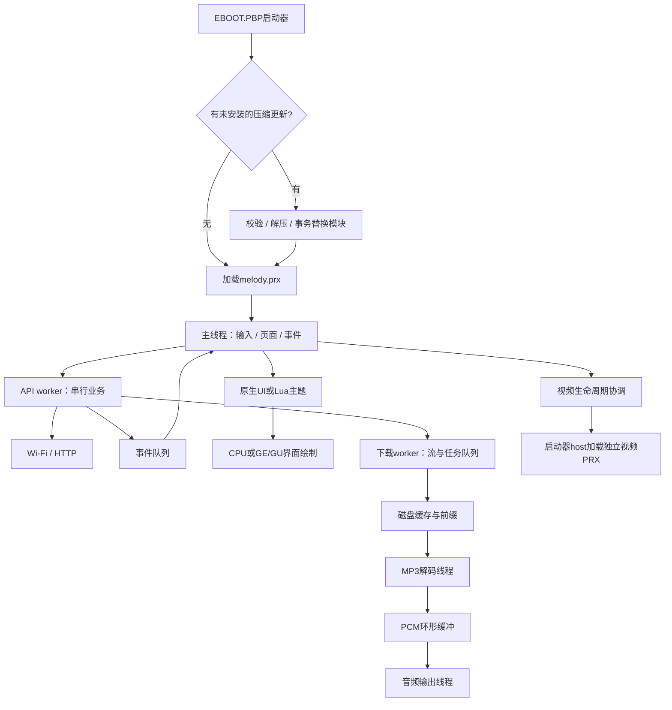
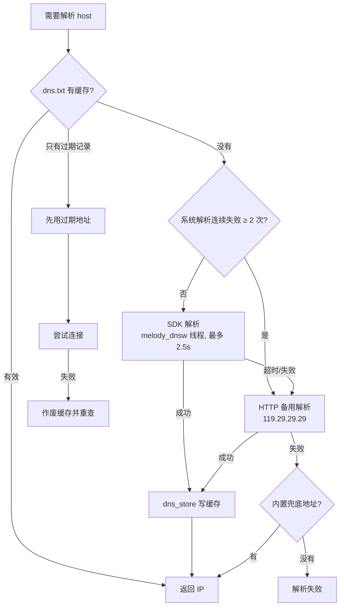
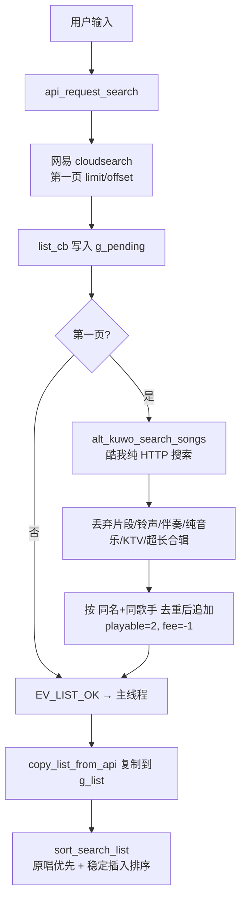
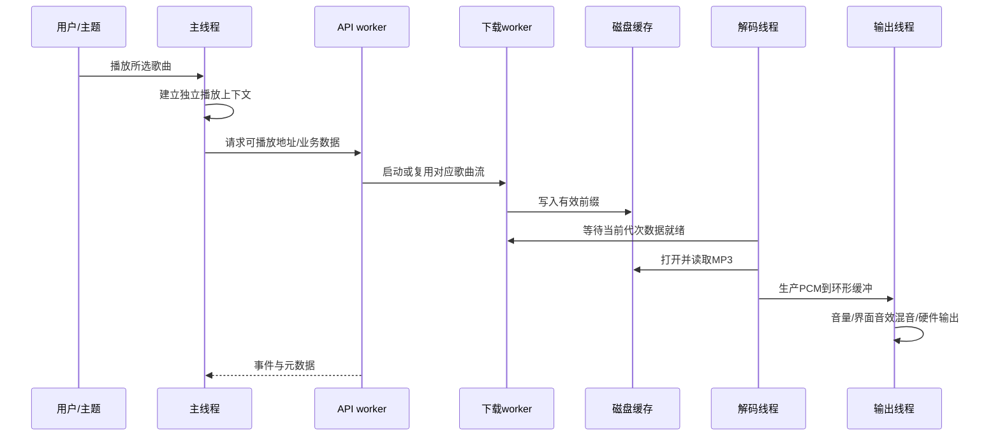
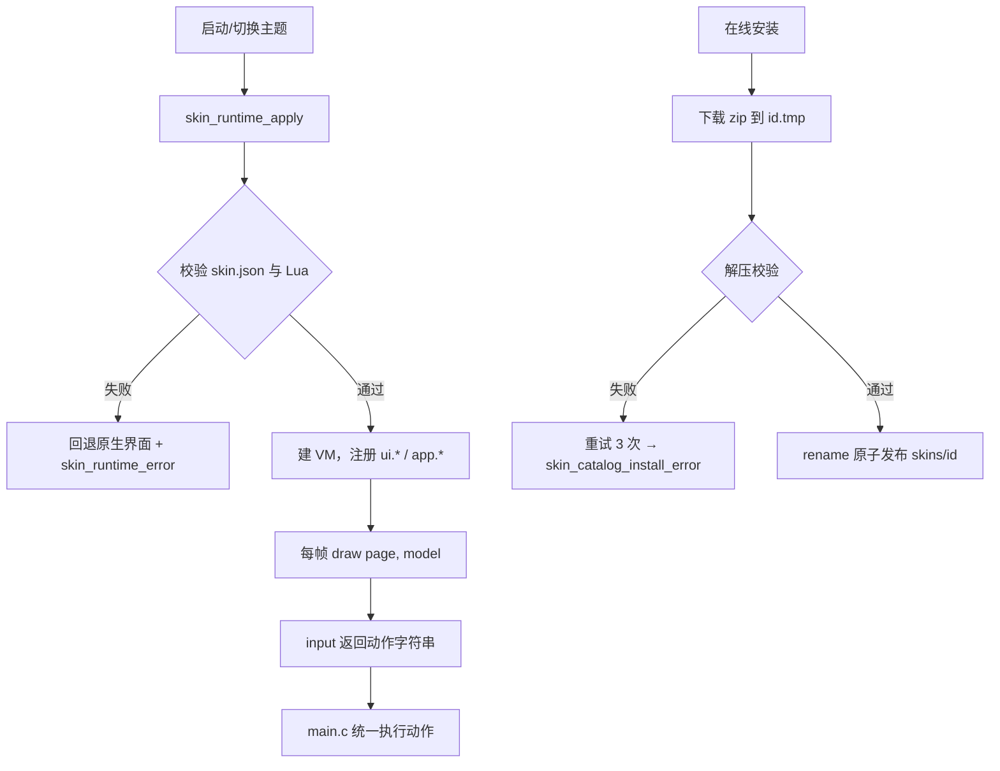
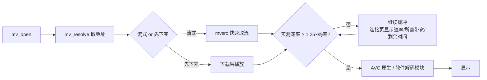
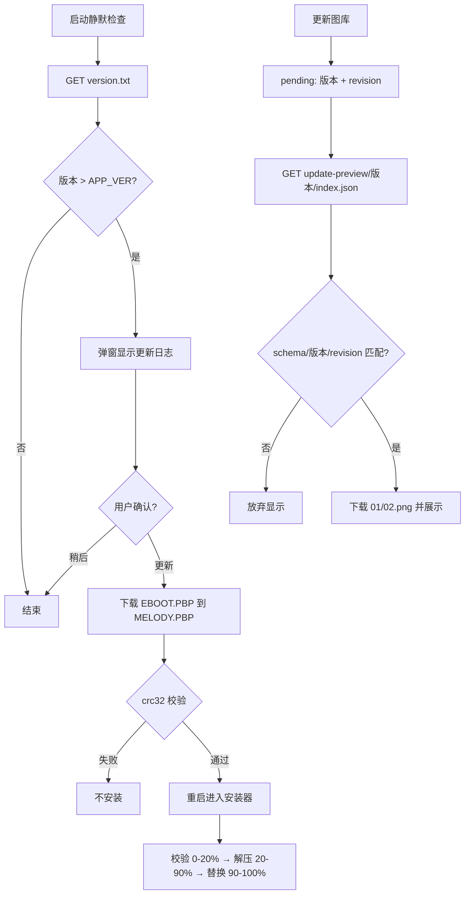

# MELODY运行逻辑说明

> 给人类维护者与AI阅读。想快速定位修改范围，先看 [AI-READ-FIRST.md](AI-READ-FIRST.md)。本页解释当前系统如何协作，不展开每个函数的实现。
>
> 最近核对：2026-11-08；当前源码版本 **4.1.1**，版本与公共结构以 [src/app.h](src/app.h)为准。实验报告和历史版本不能自动视为当前能力。
>
> 改动流水在 [WORKLOG.md](WORKLOG.md)：每次修改先在那页顶部记一条，本页只维护「系统现在怎么工作」。

## 问题与历史数据从哪里读

本页描述运行结构，问题状态与历史测量另行维护：

- [主题编辑指南](docs/THEME-EDITING-GUIDE.md)：实际修改Metro／XMB的颜色、布局、资源、动画和操作，及对应验证流程。
- [网络端已知问题](docs/NETWORK-KNOWN-ISSUES.md)：HTTPS、登录、歌曲喜欢／歌单收藏、上传及网络恢复的当前限制和验证缺口。
- [视频问题与历史实验](docs/VIDEO-STATUS-AND-EXPERIMENTS.md)：软件解码与固件路径的条件、历史真机／模拟器数据、High与VME实验边界。
- [证据与交接规范](docs/EVIDENCE-AND-HANDOFF.md)：如何记录数据、保留来源以及区分当前产品能力与局部实验。

后续改动上述系统时，应同时检查对应专题、本页及AI入口。专题用于减少重复研究，不等于要求每个任务全读所有历史材料。

> 本轮MV修订见 [4.0.1下载恢复与在线数据源记录](docs/MV-4.0.1-RECOVERY.md)：未完成任务保留、严格Range恢复、旧部分文件验证续传，以及回调路径解析。网络/视频专题应同步维护。

## 1. 软件由什么组成

MELODY是运行于PSP的音乐软件，包含在线业务、歌曲流式播放、离线缓存、本地音乐、评论、Lua主题和独立视频播放模块。PSP1000的内存预算是架构的重要约束：UI工作区、网络缓冲、音频和视频不能无限同时保留。

| 层 | 主要文件 | 职责 |
|---|---|---|
| 小型启动器 | [loader.c](tools/prxloader/loader.c)、[bundle_update.h](tools/prxloader/bundle_update.h) | 定位软件目录、安装压缩更新、加载主PRX，提供视频模块host服务 |
| 主程序入口与控制器 | [prx_entry.c](src/prx_entry.c)、[main.c](src/main.c)、[app.h](src/app.h) | 初始化、主循环、输入、页面、事件消费、业务动作与资源协调 |
| API业务 | [api.h](src/api.h)、[api.c](src/api.c) | 在线查询、取播放地址、账号、歌词、评论、皮肤和更新业务 |
| HTTP/Wi-Fi | [net.h](src/net.h)、[net.c](src/net.c) | APCTL、DNS、连接、请求响应、取消及重连 |
| 下载／缓存／本地文件 | [dl.c](src/dl.c)、[cache.c](src/cache.c)、[local.c](src/local.c) | 流前缀、队列暂停续传、磁盘索引、本地扫描与导出 |
| 音频 | [audio.h](src/audio.h)、[audio.c](src/audio.c) | 缓冲、MP3解码、输出、音量、进度、暂停与MV音频所有权交接 |
| 原生UI及主题 | [ui.c](src/ui.c)、[skin_runtime.c](src/skin_runtime.c)、[skin_catalog.c](src/skin_catalog.c) | 原生页面、Lua模型与沙箱、主题安装与回退 |
| 绘图后端 | [gfx.c](src/gfx.c)、[gfx_gu.c](src/gfx_gu.c) | CPU或GE/GU绘制、裁剪、帧同步、截图 |
| 视频协调 | [mv.c](src/mv.c)、[melody_host.h](src/melody_host.h)、[psp_video.h](src/psp_video.h) | 渐进数据源、内存让渡、独立PRX调用、播放结果及退出恢复 |
| 持久化及辅助模块 | [store.c](src/store.c)、[session_store.h](src/session_store.h)、[community.c](src/community.c)、[update_gallery.c](src/update_gallery.c) | 设置、会话事务、隐私／公告、更新图片预览 |

### 总体关系



这张图表示所有权与主要数据方向，不表示每个箭头都创建线程。

## 2. 启动：先定位目录，再建立各子系统

### 2.1 启动器阶段

启动器从启动参数中的实际EBOOT路径确定工作目录，支持分类插件子目录、空格目录及不同存储前缀。随后执行bundle安装逻辑，再加载主程序。

在线更新PBP包含压缩模块；手动安装目录中的小PBP主要负责加载模块。二者用途不同，不能互相替代后上传。

启动器以 `MelodyHost*`加实际目录信息启动主PRX。主PRX执行独立C运行库初始化，保存传入目录，在 `melody_main`线程中设置PSP文件目录和libc工作目录，再进入 `app_main()`。因此不再依赖固定的 `ms0:/PSP/GAME/MELODY/`。

### 2.2 主程序阶段

当前 `app_main()`的主要顺序：

1. 控制器采样、退出回调、绘图与日志初始化，分配独立播放上下文。
2. 检查上一轮下载的更新文件，在满足校验条件时执行启动替换逻辑。
3. 设置时钟与SDK兼容参数，初始化应用状态及UI。
4. 隐私确认；未接受时在音频、网络、API初始化前退出。
5. 提前预留空闲MV数据源worker，避免稍后创建线程栈造成连续内存碎片。
6. 加载更新预览标记，初始化设置和缓存索引，恢复音质、主题、界面渲染后端等选项。
7. 初始化音频、下载、网络与API，随后请求网络探测并进入主循环。

`ui_init()`及主题恢复可能在设置恢复前参与启动；不要把上面摘要误写为“所有主题只在store_init之后加载”。修改顺序前应读实际入口。

### 2.3 相对路径与线程目录

这是当前最重要的运行边界之一：

- 应用资源与配置的逻辑根为 `APP_DIR "./"`。
- libc的 `getcwd()`和PSP `sceIo*`所用线程工作目录不是同一个概念。
- API worker有自己的 `api_bind_directory()`；音频、下载、MV等文件I/O线程使用 [thread_paths.h](src/thread_paths.h)的绑定函数。
- 新线程、重建线程都要在第一次文件I/O前绑定。只在主线程设置目录不足以保证后台可读写。
- 独立视频PRX有独立运行库；主程序在跨模块传递文件和日志参数时，根据**实际**安装目录解析路径。这种动态解析不等于写死某个安装位置。
- 系统音乐导出目录和固件位置属于系统资源，不应机械改成应用目录。

曾出现的典型现象：主线程能读取缓存歌曲大小，解码线程打开同一相对路径却返回 `0x8002032C`。这不是MP3损坏，排查入口应是线程目录和文件I/O，而不是先更换音源或删除缓存。

## 3. 主循环：谁决定页面和动作

主线程维护 `g_app`等状态，轮询控制器和API事件，计算页面逻辑，最后绘制并提交一帧。

主要处理层次包括：退出／模态处理、全局快捷键、主题输入、未被主题消费的原生页面输入、主题动作消费、播放／视频生命周期状态以及绘图。精确优先级以当前主循环为准；这里的层次不是给新代码任意重排的许可。

关键约定：

- `set_screen()`是页面跳转的重要集中点，维护返回上下文并请求页面过渡。
- `pump_events()`消费API结果。异步请求回来时不能无条件把用户从已离开的页面拉回去。
- 全局快捷键可能抢在主题前消费按键。搜索△曾被“回播放器”覆盖，修复时必须同时看全局分支和 `input_search()`。
- Lua `skin.input()`返回真表示已消费；否则原生逻辑继续处理。
- Lua `app.dispatch()`是**单槽待处理动作**，不是无限FIFO。主线程 `skin_actions_tick()`消费后执行真实业务；不要在一个回调中假定连续提交多个动作都能保留。
- 功能弹窗当前为立即覆盖显示／关闭，不自动翻页。页面导航和数据就绪后的分类内容仍可播放过渡。
- Metro与XMB首页SELECT打开设置；主题入口另有皮肤页及既有组合快捷键。

### 返回的含义

XMB采用明确父级，不再把每次页面变化压成“撤销历史”：歌词／评论回播放器，内容页回相应目录，根功能回主页；下载和离线的虚拟文件夹层由主题配合程序处理。浏览选择、滚动、分类等仍由所属状态维护。

## 4. API：请求不是全部严格FIFO

[api.c](src/api.c)包含大量业务，但核心模式是“请求提交 → worker执行 → 事件回主线程”。

当前worker调度大致为：

1. 优先槽 `g_play`中的即时业务。
2. 普通业务队列 `g_jq`。
3. 下载队列有空间时的待入队下载。
4. 无待下载时的每日预览任务。
5. 完全空闲时的更新图片抓取。

播放、搜索等即时请求可更新优先槽并取消旧任务意图，但会保留指定下载／更新任务；联想、评论回复等同类未执行任务可合并。更新下载可插到普通队列前部。具体规则集中在 `queue_job()`，不要将其简化成“所有网络请求严格按提交顺序执行”。

### 并发边界

API业务的共享缓冲、账号会话、解析状态由其worker串行使用；不能随手新建HTTP线程并同时读写这些全局状态。DL和MV数据源有各自的流处理路径，也不意味着它们可以并发调用任意API业务解析函数。

请求和结果常带代次／取消标记，防止旧歌的地址、旧搜索结果或旧账号信息污染新状态。修复取消时，必须区分用户主动取消、切歌替换、断网和API线程退出。

### 网络与账号能力边界

当前网络层包含APCTL连接、DNS、TCP/HTTP、超时和重连。 明确的手动重连走 `net_manual_connect()`，退休旧空闲连接和DNS、重新关联，再以HTTP JSON响应确认服务；手动连接请求进入即时优先槽，不能退化为GOT_IP直接返回或仅TCP探测成功。见 [本轮修订](docs/NETWORK-MANUAL-RECOVERY-4.0.1.md)。自动关联有自己的所有权和期限，超时不能随意打断手动连接；用户主动断开后也不能马上自动连回去。

当前产品的URL解析仍拒绝HTTPS。已有扫码／喜欢／收藏业务入口，不代表所有服务端接口端到端已验证；读取播放记录也不等于上传听歌时长。现代TLS和Tilefinch资料参见独立研究报告，不属于已经接入的运行链路。

### 4.1 开机联网与DNS就绪

`GOT_IP`不等于DNS可用：PSP在DHCP下发DNS服务器之前就可能报告已拿到IP，此时调用SDK解析器会阻塞十几秒甚至更久。
因此 `net_apctl_connect()` 在拿到IP后先用 `apctl_dns_ready()`（读 `PSP_NET_APCTL_INFO_PRIMDNS/SECDNS`）等配置，最多6秒；
`dns_lookup_raw()` 解析前再等最多2秒，并且**解析本身在常驻 worker 上执行**（`dns_submit`/`dns_wait_job`），
调用方最多等 `DNS_JOB_DEADLINE_MS=2500ms` 就放弃——SDK 解析器卡死时，播放/搜索不会跟着卡。
结果按代次号发布，陈旧结果不会冒充新任务；卡死的 worker 最多创建 3 个，之后降级到缓存/兜底IP。
日志对应行：`dns ready after Nms`、`dns wait timeout …`、`dns done ms=… result=…`、`dns use fallback early`。

**系统 DNS 解不出 CDN 域名时的兜底**（4.1.1 起）：现场日志显示运营商 DNS 对
`m7/m701/m801.music.126.net` 每次都会撞上 2.5 秒上限，导致「缓存的歌能放、没缓存的全报网络连接失败」。
因此 `dns_lookup()` 的顺序是：缓存 → 过期地址 → SDK 有界解析 → **纯 HTTP 备用解析** → 内置地址 → 失败。
备用解析走 `dns_http_query()`：`http://119.29.29.29/d?dn=<host>&ttl=1`，按 IP 直连、本身不需要域名解析，
带 `g_dns_http_busy` 递归保护；解析结果照常写入 `dns.txt`。
系统解析连续失败两次后，后续查询直接先走备用解析（`dns http first <host>`），成功一次即恢复原顺序。
日志对应行：`dns http ok <host>`、`dns http first <host>`。



开机自动连接不再硬编码 profile 1..3：`job_probe()` 先用 `net_last_profile()`（上次成功），再遍历 `net_list_profiles()` 的全部已配置项。
新增连接配置放在任意槽位都应当能自动连上。

### 4.2 搜索的第三方来源

网易公开搜索索引对热门华语歌手经常先给翻唱/他人作品，因此 `job_search()` 在第一页会用
`alt_kuwo_search_songs()` 补充酷我搜索结果（纯HTTP、免鉴权），去重后追加，播放/下载走备用音源路径
（这些行 `playable=2`、`fee=-1`，界面标「酷我」）。酷我结果里的片段、铃声、伴奏、纯音乐、KTV、超长合辑在解析阶段丢弃。
排序见 `main.c:song_score()`：翻唱/改版/DJ/Live/演唱会/片段一律扣分，查询词命中歌手加分，第三方行加分。



搜索页在 4.1.1 之后多了三块内容，都不改网络层：

- **输入法**（`src/ime.c`）：拼音用「全拼连写」做前缀匹配；日语先把罗马字转平假名，
  再用读音查词条，候选顺序 = 完全匹配 → 前缀 → 假名原文 → 片假名。词表是离线生成的
  `ime_dict_data.h`（`tools/build_ime_dict.py`），运行时只读、固定候选缓冲。2026-11-11起保留全部字体覆盖的多音字读音，20,892字/27,285读音关系/420音节，合并jieba MIT词频子集到8,313中文词；单字组不截15个，候选上限512，Lua不再截前6个。本地联想有文字索引，拼写、上屏、删除都会刷新。
- **搜索历史**（`src/search_history.c`）：最多 8 条、重复前移，持久化在 `data.txt` 的 `H|` 行，
  `store_init/save` 负责读写；页面上作为**右列竖排**显示前 3 条。
- **输入模式**：□ 循环 拼音 → 假名 → **英文直输**（`IME_ASCII`，字母直接写搜索框）→ 拼音。
  焦点行 `-1` 上排联想/推荐、`-2` 下排候选、`-3` 右列历史；空行跳过。
- **推荐搜索**（`src/search_chips.c`）：最近播放歌手 → 收藏歌手 → 内置兜底（6 个），
  每次进搜索页/搜索完成后重建。

AI 接手时注意：`input_search()` 里字母先喂 `ime_feed()`，只有它返回「已上屏」才写 `query`；
`L/R` 在输入态不再是切分类，而是候选内移动（详见 `docs/SEARCH-UI.md`）。

QQ 音乐不可用：其接口只有 HTTPS，而当前 `net.c` 的 URL 解析明确拒绝 HTTPS（见第4节）。要接QQ需要额外网关/中继，
且同样受版权限制，因此没有接入。

## 5. 歌曲播放：浏览列表与播放列表分开

### 5.1 在线歌曲的主要链路



缓存命中与本地文件会跳过部分取地址和下载步骤。音频读线程不能先打开一个将被下载线程截断重建的旧文件；当前逻辑会先等待对应数据就绪，再打开。这是缓存中断后重播能否稳定的关键。

### 5.2 为什么两个音频线程

解码线程负责读取、MP3解码及生产PCM；输出线程负责消费环形缓冲、音量处理与向声卡提交。阻塞输出不能把网络读取和解码锁在同一个循环里。

输出链还用于计算轻量音乐幅度：真实音乐PCM在界面音效混音前采样；暂停、音频故障或MV接管时不继续报告上一首的电平。此数值驱动主题音波，是幅度可视化，不是FFT频谱或精确节拍分析。

### 5.3 稳定播放上下文

`g_list`属于可变化的浏览视图，搜索、歌单和推荐会覆盖它。当前播放上下文独立存储来源：

- 在线：歌曲列表快照。
- 本地：文件路径快照。
- 缓存：磁盘 `cache-playback.ids`保存一代稳定歌曲ID序列，按序号读取ID，再查当前缓存元数据。

因此离开列表浏览其他页面，不应改变上一首／下一首含义。缓存项被删时不能悄悄用当前列表同一行的另一首替代。

## 6. 缓存与下载：无限索引不是无限占内存

### 6.1 磁盘布局

| 文件 | 含义 |
|---|---|
| `cache/index.txt` | 权威文本元数据索引 |
| `cache/index.seek` | 可重建的二进制定位表，每项记录ID、文本偏移和字节数 |
| `cache/<id>.mp3` | 音频文件；文件存在不代表下载完整 |
| `cache/<id>.ok` | 完整缓存标记 |
| `cache/<id>.part` | 断点／前缀校验记录 |
| `cache/<id>.jpg`、`.lrc` | 封面与歌词缓存 |
| `download-queue.bin` | 持久化下载队列 |
| `cache-playback.ids` | 当前缓存播放来源的稳定ID快照 |

不设64或512首的固定歌曲上限，实际容量受文件系统、可用空间及计数范围限制。常驻内存保留有界查询缓存和少量元数据返回环；完整歌曲元数据不全部常驻。

### 6.2 读取与滚动

- `cache_get()`／`cache_find()`返回短期环缓冲地址；调用方需要长期使用时应复制。
- `cache_snapshot_page(out,max,first)`把请求窗口复制到调用方数组。当前批量实现打开定位和文本两份文件，读取整页，避免每条重新开关文件。
- 原生UI保留元数据窗口；窗口内选中项变化不读盘，接近边缘、大跨度移动或缓存代次变化时才刷新。
- Lua模型输出窗口内的内容，但 `index`是**绝对行号**，`total`是完整数量。主题不能把Lua数组下标当绝对歌曲序号。
- 缓存／本地左右快移每次8首，上下单首；首尾钳制。

### 6.3 变更与中断

元数据变更先写临时索引，再事务替换并重建定位；失败要保留旧索引。下载过程中保留有效前缀和断点，重启不应把部分文件误认为完整歌曲，也不应为解决索引容量而主动删除媒体。

DL worker维护播放流与下载队列，负责连接、落盘、暂停／恢复、完成发布及持久化。缓存中断续传依赖URL、长度和前缀校验，不能假设过期链接永久可续。

### 6.4 进度数值

对用户显示的百分比与字节只有一个来源：[dl_progress_contract.h](src/dl_progress_contract.h)。`advance_chunks()` 返回本次新补齐的字节数，`flush_part()` 只累加这个值，所以重连、重新分配区间、续传重叠都不会把同一段算两次；`done_bytes` 夹在 `[0,total]`，未发布完成时最高 99%。界面上的「已下载/总数」由同一百分比反算（`dl_bytes_from_pct`），文字和进度条不会互相矛盾。MV 页只给正在下载的那支显示实时百分比。

新增下载显示字段时，先确认它是否由这个契约推导；不要在绘制里自己乘除 `done_bytes`。


## 7. 主题、绘图和歌词

### 7.1 原生UI与Lua主题的关系

原生 [ui.c](src/ui.c)提供默认页面和公共弹窗。Lua主题通过 [skin_runtime.c](src/skin_runtime.c)读取受控模型、绘制有限命令、提交白名单动作；某页未实现或执行出错时可回到原生页面，不应让一个页面错误带垮整个应用。

主题资产位于 `skin_release/melody/skins/<id>/`，开发模板位于 `tools/skin_templates/`。`skin.json`描述主题、资产及 `preferences`；按主题ID的私有选项保存于 `skin-prefs/`。主题发布资源与用户自己的选项不是同一类文件。

Metro黑白合为单个主题，`metro_day`旧入口用于兼容迁移。XMB是音乐功能目录，分类内容可用虚拟文件夹呈现。两主题多选勾选取歌曲的 `download_marked`字段，光标与已选状态独立。

### 7.1.1 安装、应用与失败原因




皮肤安装只在API worker上做，顺序是：写暂存目录 `<id>.new` → 校验 → 备份 `<id>.old` → 换名发布。FS 操作有 3 次重试（25/50ms），失败时把**原始SDK返回码**写入 `log.txt`（`skin io: mkdir failed path=… rc=0x…`）。发布用的 `sceIoRename` 故意只试一次：一步失败必须回滚，不能被重试掩盖。

`skin_catalog_install_error()` 保存最近一次安装失败原因，不会被随后的目录刷新、预览下载清掉；皮肤页右上角常驻显示它。应用主题的结果也会进日志（`skin apply: ok id=…` / `skin apply: failed id=…: 原因`），所以「切不了主题」不再只有一闪而过的 toast。

皮肤I/O依赖线程工作目录：每个公开入口先重新绑定（API worker 在 MV 前后会被拆掉重建）。`0x80020320` 是 `SCE_KERNEL_ERROR_MFILE`（句柄耗尽），不是路径错误；遇到它要查文件句柄，而不是改路径。

Lua有内存、指令、脚本大小和绘制调用预算；做复杂列表或动画时要读当前限额，不在每帧重建整套远程数据。当前编辑器开发暂停。

### 7.1.2 主题自带字体

主题可以在 `skin.json` 里声明自己的点阵字库（与内置字库同格式 PSPF v1）：

```json
"fonts": [ { "size": 22, "file": "fonts/title.bin" } ]
```

- `src/skin_font.c`：读文件进 1.5MB arena → `skin_font_validate()` 校验（magic/版本/记录长度/
  边界/**码点升序**）→ `gfx_theme_font_attach()` 挂到对应字号；
- `gfx.c:pick_glyph()` 顺序：**主题字体 → 内置同字号 → 32→22→16 回退链**，所以主题字体只需
  包含它自己用到的字；
- 任何一项失败整体回滚（回到内置），原因写 `skin_font_last_error()` 并打 `skin font:` 日志；
- 工具：`tools/make_theme_font.py`（TTF→PSPF，支持 `--charset gbk|gb2312|ascii|kana`、`--chars`），
  校验：`tools/validate_skin_fonts.py`。

### 7.2 CPU与GE/GU

[ gfx.c ](src/gfx.c)提供公共绘制接口；CPU和GE/GU后端负责同一UI语义。GE/GU涉及命令提交、纹理／快照缓存、同步及帧缓冲切换，CPU访问显存前需遵守同步边界。

GU加速用于**界面渲染**，不能据此改变或宣称视频解码性能。截图也有独立readback流程，不能把旧显存或单色截图当实际页面。

### 7.2.1 省电与背光超时（2026-11-11）

`power_policy.h` 是可主机测试的超时/唤醒/调频/重绘决策；`power_runtime.c` 封装PSP硬件与原子配置文件。
设置ID25/26/27分别为省电、息屏时间、SoC时钟，原有ID不变。`power.cfg` 与 `.old` 保留于EBOOT目录。
输入采样后先进行唤醒吞键与策略评估；息屏时不重绘/翻页但主循环及音频下载继续。空闲省电仅降低重绘率，未宣称零刷新或实测续航收益。
MV启动前升333，网络繁忙/音频缓冲最低266；退出/强退回调恢复启动前时钟和固件背光时间。
背光用SDK用户库`sceImposeGet/SetBacklightOffTime`；失败时仅停画面输出，不能宣称物理背光已灭。
Lua提供`power_*`模型和`power_eco/power_timeout/power_clock`动作；主题`system_*`保留选项仅用户编辑时作用于全局。
完整接口、取值、固件限制与测试见 [省电说明](docs/POWER-SAVING-THEME.md)。

### 7.3 动画

[skin_transition.c](src/skin_transition.c)统一页面／分类内容过渡，复用有界快照，等待数据就绪后再揭示新内容。旧页面关闭从实际首次绘制开始计时，避免同步目录读取耗时把旧页动画跳过。

功能菜单、确认、主题选项、更新等弹窗目前直接覆盖，不主动触发翻页。选择框和目录位置由主题自身平滑计算，与整页翻动不是同一个机制。

### 7.4 歌词

API请求普通歌词／译文，并在可用时解析真实YRC词时间。共享 [lyric_motion.c](src/lyric_motion.c)根据句间隔调整滚动响应；[lyric_render.c](src/lyric_render.c)按UTF-8字节范围、真实时间与文本像素宽度做逐词覆盖。

普通LRC只整句高亮，不伪造逐字时刻。时间池是按需、有界的，超出覆盖的部分回落为普通高亮。主题应保持稳定的字号与换行几何；随当前句改变高度会产生视觉跳动，即使底层时间插值是平滑的。

### 7.5 模式隔离、独立词库、系统联网（2026-11-11后续）

`power_profile=eco/ultra`显式接管性能设置，不覆盖手动持久配置。极致模式在普通事件/封面/预取/动画之前early分支，仅`ultra_player`本地与完整缓存播放；net最终offline拒绝连接并shutdown在途socket。退出返回普通皮肤恢复手动策略。状态栏标记手动/皮肤省电。

中文词库包`ime/current.bin`为纯数据，约4.76MB常驻磁盘而不是堆。包验证后由worker准备独立句柄，主线程激活；PSP用sceIo读取、每句柄4080B缓存。候选引用按匹配数分配，s前缀4610项，Lua只收当前四个。热更新发布不可变`pack-*.bin`后原子换`ime/active.txt`指针，旧句柄不动；启动坏指针回current.bin再回内置。更新配置`ime-update.txt`首行HTTP地址，默认COS/melody/ime/current.bin；远端是否已上传需单独验收。

系统WiFi窗口与API连接通过net_dialog_begin/end独占协调；关闭前输入仅系统接收，GU提交完成后绘制系统UI，关闭恢复原渲染后端。WPA2插件是CFW特定兼容扩展，不等同网络普遍稳定性补丁。

外部超频仅桥接控制权，不调用内核PLL或假400MHz SDK频率；已启用外部控制时禁止省电profile并抑制NULL framebuffer黑屏，解除需用户实际停用插件后确认。

## 8. 视频：先让出资源，再加载独立模块




主程序不把所有视频解码资源永久保留。启动器通过 `MelodyHost`提供加载、播放、停止和确认卸载接口，主程序通过 `PspVideoOptions`传入路径或数据源、呈现及取消信息。

进入MV前的关键步骤：

1. 确认MP3解码／输出所有权已经退休，避免两个解码链同时占用音频硬件。
2. 结束API worker并处理必要等待，清理旧事件。
3. 取消／释放更新图库，挂起GU工作区，释放皮肤预览、Lua及资产，释放API缓冲和歌词时间池。
4. 检查空闲总量及连续块门槛；通过后才加载独立视频PRX和播放线程。

MV数据源可以从磁盘读取渐进前缀，处理seek、等待、取消和前沿不足。独立源worker提前预留，避免启动UI后再分配栈导致碎片。

### 8.1 边下边播的起播门槛

起播不是「缓冲到一定字节就开始」。源worker每2秒统计实测速率，`mv_stream_required_bps()` 给出视频本身需要的码率（总字节／时长）；只有实测速率达到码率的1.25倍（`mv_stream_sustainable()`）才会进入播放器，否则继续完整下载、下载完再起播。缓冲滞回的低水位是预取目标的**一半**，避免慢速链路「播几秒—停—再播」的可见卡顿。

连接页（[ui.c](src/ui.c) 的 `ui_mv_connecting`）必须回答三件事：当前阶段（取地址／连接／缓冲／网速不足）、已下载与总数及起播／下载百分比、实测速率与所需码率及剩余时间。修改起播条件或缓冲策略时同步 `tests/test_mv_stream_gate.py` 与 `tests/test_mv_buffer.py`。

正常退出需要确认播放线程结束和PRX卸载，再结束直出视频、恢复API和MP3、恢复主题／渲染器并回页面。**若线程退出或模块卸载未确认，会保留资源并进入需重启状态；不是任何错误都可以强杀后立即恢复。**

当前主程序同时保留软件视频模块与受条件限制的原生固件路径，具体能力看片源、profile及模块实现。不要从一个硬解实验目录推断所有High Profile已经原生支持。

## 9. 更新：下载、替换、预览是三段逻辑




### 9.1 检测和下载

API读取安装目录下的 `update.txt`，其首个有效地址指向版本文本；配置缺失时使用当前官方缺省地址。版本文本包含远端版本、PBP地址、大小／校验及说明，解析由当前实现负责。

检测到新版后，用户确认才下载。API worker把数据批写到 `EBOOT.NEW`，处理短写、取消、截断及完整性校验，完成后生成 `update.meta`。不能在未完成或校验失败时留下可被安装的伪完整更新。

**API线程文件目录绑定是下载写入前提。** 仅能读取版本清单，不足以证明下载写盘链路正常。

### 9.2 下次启动安装

主程序的启动更新逻辑检查候选PBP和元数据，并保留回滚路径；启动器 `mb_install()`校验压缩bundle、解压暂存模块，借助安装标记与journal执行事务替换。成功后相同bundle再次启动应跳过重复安装。

- 小启动器PBP：手动安装配合旁边PRX。
- 在线更新PBP：小启动器＋压缩模块bundle。
- `manifest.json`：实际文件尺寸与哈希，记录bundleCRC。
- `version.txt`：用户上传COS的远端版本信息，必须匹配对应在线PBP。

### 9.3 图片预览

安装成功后写 `update-preview-pending.txt`，使用**版本＋bundle修订**配对。图库从 `melody/update-preview/<version>/index.json`取得图片清单，API空闲时下载；也可读取已校验的本地缓存，以支持离线首次展示。

图库支持左右翻页，末页完成后写seen；中途关闭、失败或内存不足不弹空白页。图片工作区按需分配，关闭及MV前释放。清单revision不匹配时不应误展示另一版图片。

更新PBP不会自动包含所有远端皮肤；皮肤资源有独立发布与安装流程。因此程序更新文件、皮肤包和预览图片要分别检查，不能以一个包存在就认定三类内容均已发布。

## 10. 文件、数据与部署边界

| 类型 | 例子 | 部署处理 |
|---|---|---|
| 程序模块 | `EBOOT.PBP`、`melody.prx`、视频／固件辅助PRX | 按本次manifest覆盖并核验 |
| 发布皮肤 | `skins/<id>/skin.json`、Lua、图片／音效、目录清单 | 与程序能力配套更新 |
| 用户状态 | 设置、会话、历史、私有主题选项、活动主题 | 默认保留，不放入公开ZIP |
| 用户媒体与下载状态 | 缓存MP3、完整／部分标记、队列、ID快照 | 默认保留；仅用户明确删除时清理媒体 |
| 运行日志 | `log.txt`等 | 诊断时私有备份，公开前过滤身份信息 |
| 更新候选及标记 | `EBOOT.NEW`、meta、journal、pending／seen | 按更新状态机处理，不能随意复制旧标记到新包 |

本机H盘、Downloads与工具链路径是开发环境，不是产品约定。设备可能换盘符、进入分类目录或使用内置盘；安装前确认实际目标，不自动扫描所有无关文件。

### 10.1 开源仓库（2026-11-08 起）

> 开源仓库的文档不在本工作区内：`E:\MELODY-PSP-OPENSOURCE\MELODY-PSP\docs\`（本页出现该目录路径时，指的是开源副本，不是本目录的 `docs/`）。


源码已开源：**https://github.com/XBBDYF/MELODY-PSP**（GPL-3.0），本地独立目录为
`E:\MELODY-PSP-OPENSOURCE\MELODY-PSP`，与本工作目录是两个树。

- 本目录是**开发工作区**（含 `backups/`、`dist_*`、`releases/`、`.tmp/`、字段日志与真机备份）；
- 开源目录是**清洁副本**：只放 `src/`、`skin_release/`、`tools/`、`tests/`、`third_party/`、`docs/`、`assets/` 与构建入口；
- 同步方式见 `E:\MELODY-PSP-OPENSOURCE\MELODY-PSP\docs\WORKFLOW.md` 第 6 节（robocopy 源文件 → 跑 `tests/run_all.py` → commit → push）；
- **安装包不进仓库**，也不在 GitHub Releases 发布：二进制只在 QQ 群 1103558445 分发，
  仓库侧只保留源码与文档（分发政策见 `E:\MELODY-PSP-OPENSOURCE\MELODY-PSP\docs\GITHUB.md`）。

## 11. 验证的层次

1. **主机生产函数回归**：提取或链接真实C／Lua逻辑，检查状态、文件事务、边界与预算；PSP SDK通常由桩模拟。
2. **实际PSP程序在PPSSPP运行**：验证真实PBP／PRX组合、输入流程、页面、音频进度、模块加载及恢复。
3. **物理PSP**：验证实际固件、记忆棒、路由器、音频硬件和操作手感。

三层证据不能互相冒充。页面截图成功不等于音频成功，HTTP连接成功不等于文件写入成功，一次MV成功不等于第二次资源恢复正确。详细运行方法见 [AI-READ-FIRST.md](AI-READ-FIRST.md)。

## 12. 两份文档必须一起维护

这不是一次性的介绍文档。后续AI或人类维护者都应遵守：

- **改动流水写进 [WORKLOG.md](WORKLOG.md)**：每次修改代码/发布/关键文档，先在那页顶部加一条记录（文件与函数、证据、三层验证到哪一步、下一步）。本页只维护「系统现在怎么工作」，不承担流水账。
- 修改入口、线程职责、工作目录、模块ABI、任务／事件调度、缓存或播放上下文、更新数据格式、主题接口、构建发布流程时，**同一项工作中同步更新本页**。
- 新增／移动模块、改变常用定位方式、增加关键测试或废弃工具时，**同步更新 [AI-READ-FIRST.md](AI-READ-FIRST.md)** 的阅读路由。
- 网络或视频问题取得新证据、关闭／重开、能力限制改变时，同步维护对应专题的状态、测量环境与来源；遵循 [证据与交接规范](docs/EVIDENCE-AND-HANDOFF.md)，不要只追加一句“已修复”。
- 小范围内部修复若不改变上述事实，可以不重写全文，但交接时应说明“已核对，两份文档无需变更”及原因；不要为了记录进度堆积重复段落。
- 版本或现状变化时更新开头核对日期、状态说明和涉及章节。未运行的测试不得写成已通过；不确定的能力明确写待核验。
- 代码／发布manifest是当前事实来源，历史总结是线索。若发现文档冲突，定向读代码确认后修正文档，不复制矛盾结论。
- 提交或交付前检查相互链接、文件／函数名及示例命令；移动这两份文档时更新所有入口引用。

维护记录只保留能帮助后续定位的变化，不在本页累积整个会话日志。最近一次核对覆盖：启动目录传递、后台线程绑定、API调度、磁盘缓存窗口与ID队列、下载进度契约、主题安装重试与失败原因、MV起播门槛与连接页、主题动作、MV释放／恢复、在线更新及图库。


