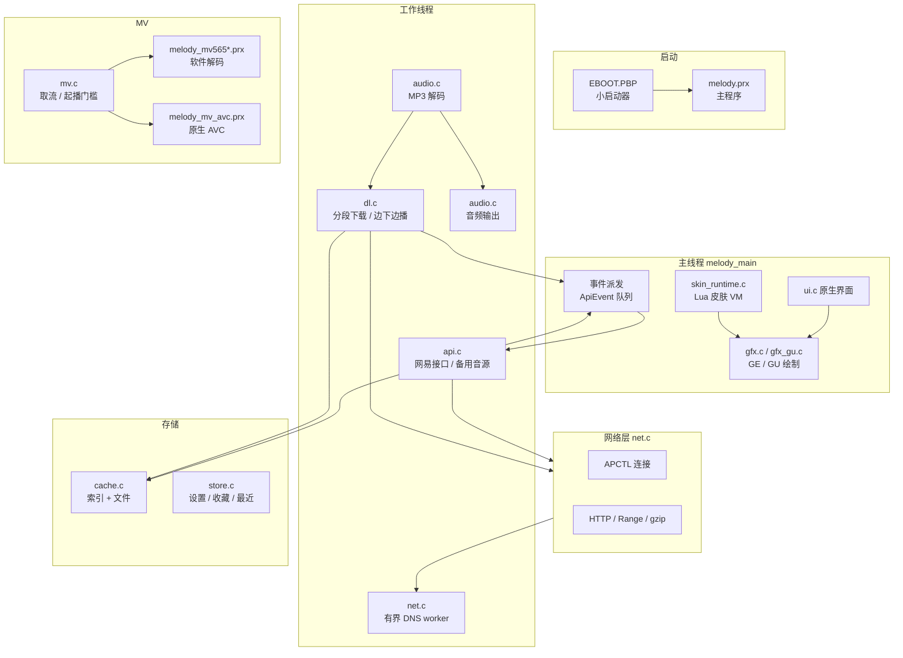
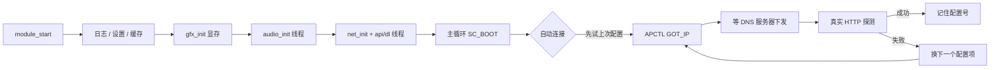
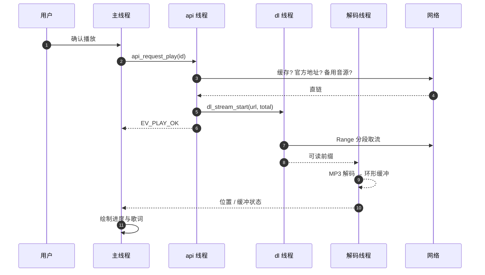
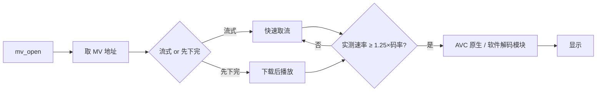
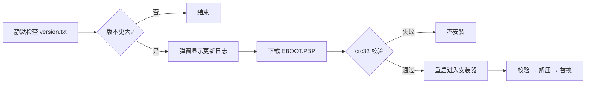
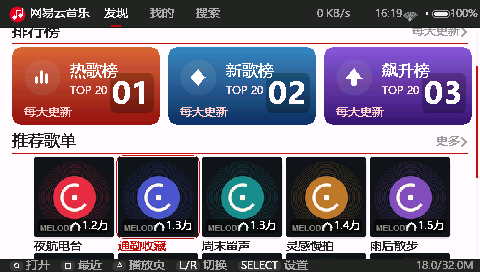
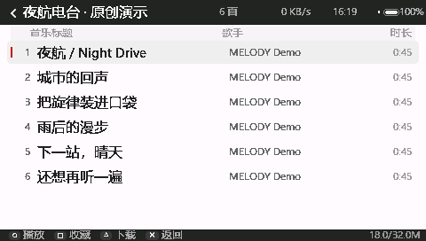
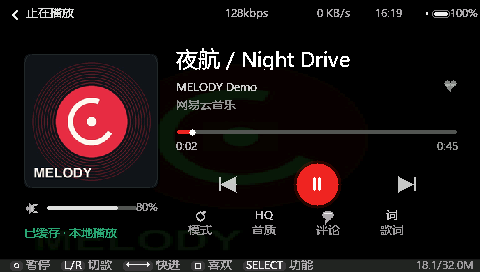
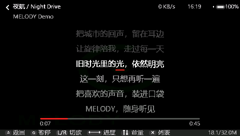
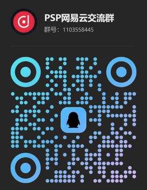

<p align="center">
    
</p>
<h1 align="center">
MELODY PSP
</h1>
<p align="center">
  一个运行在 Sony PlayStation Portable（PSP）上的第三方
  <a href="https://music.163.com">网易云音乐</a> 客户端
</p>
<p align="center">
  原生 C 实现 · 硬件 MP3 解码 · Lua 可换肤 · 在线更新
</p>
<p align="center">
  <b><a href="#特点">特点</a></b>
  |
  <b><a href="#架构">架构</a></b>
  |
  <b><a href="#安装">安装</a></b>
  |
  <b><a href="#文档">文档</a></b>
  |
  <b><a href="#开发">开发</a></b>
  |
  <b><a href="#致谢">致谢</a></b>
</p>

- - -


[](LICENSE)


MELODY 是一个面向 PSP 的原生音乐客户端。网络请求、界面渲染、音频解码、下载与
在线更新全部在 PSP 本机完成，不依赖外部串流设备；界面由 Lua 皮肤脚本驱动，
换主题不需要重新编译程序。

项目针对 PSP 的 32MB 内存、WLAN 带宽与 FAT 记忆棒做适配：列表分页、可读前缀下载、
有界 DNS 解析、解码环形缓冲，都是为「边下边播不卡、掉线能续」服务的。

目前主要在 PSP-3000（6.61 ARK）上验证，PSP-1000 / 2000 / E1000 亦可运行。

| 项目 | PSP-1000 | PSP-2000 / 3000 / E1000 |
|---|---|---|
| 支持情况 | 支持 | 支持 |
| 主程序堆 | 2MB（固定） | 2MB（固定） |
| MV 临时堆 | 7MB | 7MB |
| 像素格式 | RGB565 | RGB565 |
| MV 解码 | 软件解码模块 | 软件解码模块 / 原生 AVC（实验性） |

# 新闻

- 2026 年
  - [11/08] **4.1.1** 发布：修复部分网络下未缓存歌曲无法播放（备用 DNS 解析）、播放失败无限重试、主题切换无提示
  - [11/08] **4.1** 发布：Lua 皮肤与主题系统、GE/GU 渲染加速、唱片样式、缓存中断下载
  - [11/05] **4.0.1** 发布：手动重连重新关联、MV 尾段严格 Range 恢复、在线播放相对路径修复
  - [11/02] **4.0** 发布：缓存列表分页与窗口预读、缓存/本地左右快移恢复
  - [10/30] **3.5.0** 发布：程序目录相对路径安装（分类插件可用）、皮肤体系迁移
  - [10/28] **3.4.x** 系列：更新安装进度、歌词页控件、64KB 批量写吞吐优化

# 特点

- **原生运行**：PSP 网络连接 + 硬件 MP3 解码（`sceMp3`）+ GE/GU 绘制，全流程本机完成
- **内容浏览**：每日推荐、排行榜、推荐歌单、歌单广场、歌手榜、我喜欢的音乐、最近播放
- **搜索**：歌曲/专辑/歌手/电台四类，拼音联想，结果自动补充第三方音源并区分「原唱 / 翻唱」
- **播放体验**：在线边下边播、缓存优先、断点续传、后台预取、无缝下一首、歌单循环/随机
- **无版权可用**：网易无地址的歌曲保留在列表并标注「三方」，自动走备用音源（酷我 / 网关）
- **歌词**：逐行动画、翻译、单行/插页排版、摇杆与按键操作
- **评论**：楼层展开、点赞、楼中楼
- **MV**：在线 MV（软件解码四档画质 / 原生 AVC）、本地 `VIDEO` 目录扫描、下载与导出
- **主题**：Lua 5.4 皮肤 VM，9 套内置主题，支持安装与在线更新（`skins/<id>/skin.lua`）
- **系统能力**：在线更新（下载 + 安装进度）、开机自动连接上次网络、网速/电量显示、日志导出

# 架构

整体是「小启动器 + 主程序 PRX + 独立解码模块」的形态，业务线程全部通过事件队列
与主线程通信，主线程只做绘制与输入。



线程优先级与内存预算见 [docs/ARCHITECTURE.md](docs/ARCHITECTURE.md)。

# 运行逻辑

下面按「用户做了什么 → 程序内部发生了什么」给出主要链路的图示与步骤。
每条链路的完整细节（函数名、边界条件、日志信号）在 [docs/LOGIC.md](docs/LOGIC.md)。

## 1. 启动与联网



1. **先本地后网络**：日志、设置、缓存、显存、音频线程都先起，没网也能进界面；
2. 自动连接先试「上次成功」的配置，再遍历全部已配置项（不写死 1..3）；
3. `GOT_IP` 不等于 DNS 可用——必须等 `PRIMDNS/SECDNS` 非零，最多 6 秒；
4. 用一次真实 JSON 请求确认可用（只看 TCP 握手会误判）；
5. 成功即记住配置号，下次开机优先。

## 2. 搜索


1. 网易搜索为主，第一页额外补一次第三方搜索（纯 HTTP），结果标「酷我」；
2. 第三方结果先过滤掉片段、铃声、伴奏、纯音乐、KTV、超长合辑；
3. 合并时按「同名 + 同歌手」去重；
4. 排序：翻唱/改版/Live/演唱会/片段扣 150 分，查询词命中歌手 +90、命中歌名 +40，
   第三方可播行 +30，网易可播 +10；
5. 列表里点开第三方行，播放/下载都走备用音源。

## 3. 播放



1. 缓存完整 → 直接本地播放，不发网络请求；
2. 网易无地址（`playable=2`）→ 先走备用音源；官方取址 45x 也走备用音源；
3. 备用源顺序：byfuns → 酷我 → 本地网关 → GDStudio（设置里可关）；
4. 下载线程只写、解码线程只读，用「可读前缀」协议避免读到空洞；
5. **起播成功 = 真正播放满 2 秒**；失败最多重试 2 次，之后暂停并提示，不会无限重试。

## 4. 下载


1. `.part` 记录每片偏移与前缀哈希，断线后从原偏移续传；
2. 进度百分比由**字节数**换算（不用块数估算），不会出现 100% 却未完成；
3. MV 播放时下载队列让路；安装更新时只提高更新任务优先级；
4. 下载与缓冲共用同一个文件，靠「可读前缀」保证不读空洞。

## 5. MV



1. 起播门槛看**实测带宽**，不够就继续缓冲，连接页给出速率、所需带宽、剩余时间；
2. 解码两种路径：原生 AVC 模块（实验性）或软件模块（四档画质）；
3. 本地 `VIDEO` 目录扫描由设置项控制，默认关闭（大目录会拖慢启动）。

## 6. 皮肤与主题


1. 皮肤只画界面、只回传动作，不直接改状态；
2. VM 有内存与字符串工作量预算，超限回退原生界面而不是崩溃；
3. 在线安装：下载 → 校验 → `rename` 原子发布，写卡失败重试 3 次并显示原因。

## 7. 在线更新



1. `version.txt`：版本 / 地址 / 字节数 / crc32 / 更新日志；
2. 校验通过才安装；安装分「校验 0-20%、解压 20-90%、替换 90-100%」三段；
3. 安装后首次启动会拉取该版本的更新展示图（版本 + revision 必须匹配）。

# 界面截图

<p align="center">
  
  
</p>
<p align="center">
  
  
</p>
<p align="center">
  <em>首页 · 歌曲列表 · 播放页 · 歌词页（480×272 原始尺寸）</em>
</p>

完整截图（MV、设置、关于，以及 9 套主题皮肤）见 **[截图页](docs/SCREENSHOTS.md)**。

# 安装

> **本仓库不提供安装包。** 源码仓库只放代码、皮肤、测试与文档；
> 编译好的安装包（完整安装 / 在线更新 / 一键替换）在 **QQ 群 1103558445** 的群文件里，
> 按版本号取用。这样做是为了让源码与二进制各自有唯一来源，避免过期包被反复转发。

### PSP

1. 在 QQ 群文件里下载对应版本的安装包（当前 **4.1.1**）。
2. 解压后把 `PSP` 目录合并到记忆棒根目录（或使用包内的「一键替换」）。
3. 从 PSP 游戏菜单启动 MELODY。

最终路径应为：

```text
ms0:/PSP/GAME/MELODY/EBOOT.PBP
ms0:/PSP/GAME/MELODY/melody.prx
```

> 启动器会先初始化网络与模块加载，**不要**直接运行 `melody.prx`。

### 在线更新

程序内「设置 → 检查更新」会读取 `update.txt` 指向的版本文件，下载校验后
进入安装器（校验 → 解压 → 替换），不需要拔卡。

### 从源码构建

见 [docs/BUILD.md](docs/BUILD.md)。最短路径：

```sh
export PATH="/path/to/pspdev/bin:$PATH"
make                            # 生成 melody.prx
./tools/prxloader/build.sh      # 生成启动器 EBOOT.PBP
```

MV 软件解码依赖 WiliMini 的解码头文件与 FFmpeg 静态库，路径用变量覆盖：

```sh
make WILIMINI=/path/to/WiliMini
```

# 文档

| 文档 | 内容 |
|---|---|
| [架构说明](docs/ARCHITECTURE.md) | 进程/线程模型、模块分层、网络三层策略、内存预算、数据契约 |
| [关键逻辑](docs/LOGIC.md) | 启动联网、搜索、播放、下载、MV、皮肤、更新、诊断（含流程图） |
| [截图页](docs/SCREENSHOTS.md) | 原生界面 7 张 + 9 套主题皮肤 + 更新展示图 |
| [工作流程](docs/WORKFLOW.md) | 开发 → 测试 → 打包 → 发布到群 → 同步开源 的完整流程 |
| [GitHub 记录](docs/GITHUB.md) | 仓库地址、分支、提交历史、推送方式、Issue 与分发政策 |
| [构建说明](docs/BUILD.md) | 环境、依赖、命令、宿主机测试、打包发布 |
| [皮肤与主题](docs/THEMES.md) | `skin.json` 字段、页面名、`ui.*` / `app.*` 全部宿主 API |
| [测试说明](tests/README.md) | 测试分类、写法约定、需要额外产物的集成用例 |
| [更新记录](CHANGELOG.md) | 4.1.1 → 4.1 → 4.0.1 → 4.0 → 3.5.0 → 3.4.x |
| [第三方组件](THIRD-PARTY-NOTICES.md) | 每个依赖的许可证与影响 |
| [致谢](CREDITS.md) | 人与项目 |

# 功能状态

| 模块 | 状态 |
|---|---|
| 主程序构建与打包 | 可用 |
| 发现 / 排行榜 / 歌单 / 歌手 | 已接入 |
| 搜索（4 类 + 联想 + 三方补充） | 已接入 |
| 在线播放（边下边播） | 已接入 |
| 缓存 / 下载 / 断点续传 | 已接入 |
| 歌词（翻译、排版、动画） | 已接入 |
| 评论 / 楼层 / 点赞 | 已接入 |
| MV 软件解码（四档画质） | 已接入 |
| MV 原生 AVC | 实验性 |
| Lua 皮肤与在线主题 | 已接入 |
| 在线更新（下载 + 安装） | 已接入 |
| 第三方音源（酷我 / 网关） | 已接入，可在设置关闭 |
| 本地 `VIDEO` 目录 MV 扫描 | 已接入，默认关闭 |
| 直播 / 私信 / 云盘 | 不支持 |

# 操作说明

| 按键 | 操作 |
| --- | --- |
| 方向键 / 摇杆 | 移动焦点、滚动列表 |
| ○ | 确认（播放、进入） |
| × | 返回 / 取消 |
| L / R | 切换顶部标签页 |
| SELECT | 打开设置；播放页打开菜单 |
| △ | 列表页下载当前歌曲；播放页相关操作 |
| □ | 收藏 / 取消收藏当前歌曲 |
| START | 列表页退出程序 |

> 按键在不同页面略有差异，界面底部会给出当前页可用操作提示。

# 开发

## 环境准备

需要 PSP 工具链（[pspdev](https://github.com/pspdev/pspdev)）与 msys2：

```sh
export PSPDEV=/path/to/pspdev
export PATH="$PSPDEV/bin:$PATH"
```

Windows 下建议用 `D:/msys64/usr/bin/bash.exe` 运行仓库里的 `build.sh` / `make`。

## 构建

```sh
make                              # 主程序
./build.sh src/main.o src/ui.o    # 只构建改动的模块（更快）
./tools/prxloader/build.sh        # 启动器
```

## 宿主机测试

```sh
python -B tests/run_all.py        # 125 个自包含用例
```

需要额外产物的用例在 `tests/integration/`，说明见 [tests/README.md](tests/README.md)。

## 打包与校验

```sh
python -B tools/prxloader/package_versioned_release.py 4.1.1   # 生成完整安装 + 在线更新包
python -B tools/make_update_splash.py 4.1.1                    # 生成更新展示图
python -B tools/validate_skin_runtime.py skin_release/melody/skins/metro
```

## PPSSPP 冒烟

把完整安装目录放进一个带 `portable.txt` 的 PPSSPP 目录即可启动；
日志 `log.txt` 首行会打印版本号与编译时间，便于确认跑的是哪一版。

PPSSPP 可以验证界面、下载与播放器逻辑，但**不能**替代真机的 UMDFAT、
WLAN 与 Media Engine 行为。

# 项目结构

```text
src/                    主程序（C，PSP PRX）
  main.c                屏幕状态机 / 输入 / 事件派发
  ui.c                  原生界面绘制
  api.c                 网易接口 + 备用音源调度
  net.c                 APCTL / DNS / HTTP
  dl.c                  分段下载与边下边播
  audio.c               MP3 解码与输出
  mv.c / mvsrc.c / mvexport.c   MV 取流、播放、导出
  skin_*.c              Lua 皮肤运行时与组件
  *_contract.h          纯逻辑契约（可被宿主机测试）
tools/
  prxloader/            启动器、打包与校验脚本
  mvtest/               MV 解码冒烟程序
  skin_templates/       metro / xmb 模板源文件
skin_release/melody/skins/   可安装的示例皮肤（9 套）
third_party/            Lua 5.4.7、libjpeg-turbo（coverjpeg 封装）
tests/                  宿主机回归测试
docs/                   架构、逻辑、构建、主题文档与截图
assets/                 启动图标与背景图
```

# 反馈问题前

1. 确认使用的是**完整安装目录**，而不是只替换了 `melody.prx`；
2. 在 PSP 上重现一次，导出 `ms0:/PSP/GAME/MELODY/log.txt`；
3. 提供设备型号、固件版本、自制系统（如 6.61 ARK）、当前主题；
4. 描述现象时带上「哪首歌 / 哪个页面 / 卡了多久」，最好附截图；
5. 先搜一下已有 [Issues](https://github.com/XBBDYF/MELODY-PSP/issues)。

日志里几个有用的信号：

```text
dns http ok <host>            系统 DNS 失败，走了 HTTP 备用解析
audio error, retry N: 原因     解码 / 取流失败
dl stream: begin failed …     下载流没起来（err 是具体原因）
```

# 贡献

欢迎 Issue、文档改进与 Pull Request，细节见 [CONTRIBUTING.md](CONTRIBUTING.md)。

- 改动前先说明对应的现象与根因，不要只贴 diff；
- 涉及时序的改动请补 `tests/` 用例；
- 不提交缓存音频、账号 Cookie、真机备份与私人日志；
- 真机结论与模拟器结论请分开写，不要把 PPSSPP 结果当成真机结果。

# 许可证

MELODY 以 **GNU General Public License v3.0** 发布，见 [LICENSE](LICENSE)。

主程序静态链接了 WiliMini 的解码实现（GPL-3.0）与 FFmpeg（LGPL-2.1-or-later），
按 GPL 兼容性要求，合并后的可执行文件整体按 GPL-3.0 分发。
`third_party/` 下的组件保留各自许可证。

> 本项目是非官方客户端，与网易公司无关，不提供、不托管任何音乐内容。
> 所有音视频均来自第三方公开接口，版权归原权利人所有，仅供个人学习与试听。

# 致谢

感谢以下项目与贡献者。**参考的第三方项目与其协议均在下表标注**，
每个依赖的具体版本、使用范围与许可证原文见 [THIRD-PARTY-NOTICES.md](THIRD-PARTY-NOTICES.md)。

## 代码依赖

| 项目 | 使用内容 | 许可证 |
| --- | --- | --- |
| [WiliMini](https://github.com/wilimini/WiliMini) | MV 软件解码参考实现（`pspvideo`）、FFmpeg 在 PSP 上的裁剪 | **GPL-3.0** |
| [FFmpeg](https://ffmpeg.org/) | MV 容器解析与音视频解码 | **LGPL-2.1-or-later** |
| [PSPSDK / pspdev](https://github.com/pspdev/pspdev) | 工具链、`sce*` 接口、启动器打包 | **BSD-3-Clause** |
| [Lua](https://www.lua.org/) | 皮肤与主题脚本虚拟机（5.4.7） | **MIT** |
| [libjpeg-turbo](https://github.com/libjpeg-turbo/libjpeg-turbo) | 封面 JPEG 解码（经 `coverjpeg_psp` 封装，仅解码） | **BSD-3-Clause / IJG / zlib** |
| [zlib](https://zlib.net/) | gzip 解压、更新包压缩 | **zlib License** |
| newlib / GCC libgcc | PSP C 运行库与编译器运行时 | **BSD 风格** / **GPL-3.0 + GCC Runtime Exception** |
| [PSP ME MIST / Custom Core](https://github.com/mcidclan) | Media Engine 硬解流程研究 | **MIT** |

## 字体与素材

| 项目 | 使用内容 | 许可证 |
| --- | --- | --- |
| 思源黑体（Source Han Sans） | 点阵字库来源字体 | **SIL OFL 1.1** |
| [WenQuanYi Micro Hei](https://sourceforge.net/projects/wqy/) | 点阵字库来源字体 | **Apache-2.0** |

## 参考资料（未直接包含代码）

| 项目 | 用途 | 许可证 |
| --- | --- | --- |
| [PPSSPP](https://github.com/hrydgard/ppsspp) | PSP 接口行为对照与模拟器验证 | GPL-2.0-or-later |
| [PMPlayer Advance](https://github.com/DavisDev/pmplayer-advance) | AVC 解码流程参考 | GPL-2.0 |
| [NeteaseCloudMusicApi](https://github.com/Binaryify/NeteaseCloudMusicApi) | 接口字段与调用方式资料（未内置该服务） | MIT |
| [MElib](https://github.com/IridescentRose/MElib) | ME 通信研究 | MIT |

## 交流与支持

- QQ 群：**1103558445**（PSP 网易云交流群）
- 爱发电：[afdian.com/a/hoi4-province-editor](https://afdian.com/a/hoi4-province-editor)
- 作者：[XBBDYF](https://github.com/XBBDYF) · B 站 [535975174](https://space.bilibili.com/535975174)

<p align="center">
  
</p>
