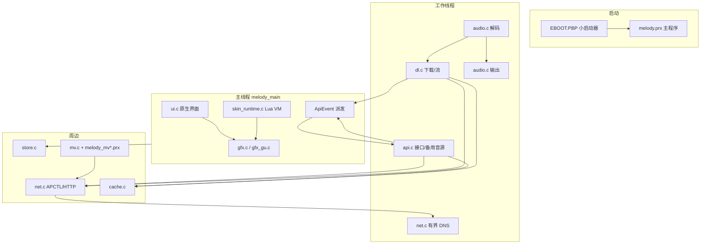

# MELODY 修改台账（WORKLOG）

> 每次改代码/发布/文档，**先在下面加一条，再把细节写进 `docs/`**。接手时只读最新一条 + 它链接的文档，不要重读整个 `src/`。
> 阅读顺序：本页 → [AI-READ-FIRST.md](AI-READ-FIRST.md) → 记录里点名的文件。版本以 [src/app.h](src/app.h) 为准（当前 `4.1.1`）。

## 2026-11-11：省电控制与中文输入法覆盖修复

- 新增`power_policy.h`和`power_runtime.c/h`，设置ID25..27：省电开关、背光超时、SoC目标频率。配置原子写入power.cfg，失败回滚；退出恢复初始硬件设置。
- SDK用户态背光计时接口经上游源码和本地stub双重核实；不再把仅停止framebuffer等同于物理关背光。仅支持30秒起；失败UI标明“仅画面”。
- 主循环空闲重绘降帧、息屏停绘制、唤醒吞键；HOLD不计活动；MV启动前333MHz、API繁忙/缓冲最低266；硬件频率读回支持休眠变化和PLL整数取整。
- ECO主题提供三项主题设置及首页省电快捷键；主题加载不自动改变用户电源设置。文档与THEME-KIT补接口。
- 缺“祝”复现后移除生成/运行时/主题模型三层截断。20,892汉字、420音节、27,285字音关系；8,313中文词、63日语词。jieba与pinyin-data均保留MIT许可；多音词未经人工覆盖时仍可能读音不准。
- 验证：新增策略/硬件适配/完整候选链路测试；完整主机回归136项通过。PRX全模块重编译并修复SDK用户导入桩顺序。模拟器/装卡证据在本轮交付manifest记录，不将其写成物理PSP续航测量。
- 修复旧测试夹具漏声明g_src_rate_bps（此前被误记为缺解码器依赖），16个MV尾段恢复用例全部通过；设置测试数量更新为28，旧ID不变。
- 详见[省电策略](docs/POWER-SAVING-THEME.md)、[输入法覆盖](docs/IME-AND-FONTS.md)。

## 系统全景（快照：截至会话12，不随每次会话更新）



> 这张只是「谁和谁连」的总览。具体链路的图在 `PROJECT-RUNTIME.md` 各章节（§4.1 DNS、§5.1 播放、
> §6 下载、§7.1.1 皮肤、§8 MV、§9 更新），工作流图在开源仓库 `docs/WORKFLOW.md`。


## 记录格式

```text
## YYYY-MM-DD · 会话N：标题
改了什么：文件 + 函数（一行一项）
证据：日志片段 / 现象
验证：主机回归 / PPSSPP / 物理PSP（分开写）
产物：文件 + 大小 + SHA256
未完成：下一步最小动作
细节：docs/xxx.md
```

---

## 2026-11-08 · 会话1：下载进度、主题切换、MV 起播

- **改了什么**
  - 新增 `src/dl_progress_contract.h`：进度唯一出口（只计新补齐字节、夹到总长、未完成最高 99%）。
  - `dl.c`：`advance_chunks()` 返回新增字节，`flush_part()` 按此累加；队列/暂停/失败百分比统一。
  - `skin_catalog.c`：文件操作 3 次重试 + 失败写 SDK 返回码；`sc_bind()`；`skin_catalog_install_error()`；安装日志。
  - `main.c`：记录 `skin apply: ok|failed`；MV 起播增加网速条件。
  - `ui.c`：下载行显示「已下载/总数」；MV 页只给正在下载的那支显示百分比；皮肤页常驻失败原因；MV 连接页显示阶段/速率/剩余时间。
  - `mv.c/h`：实测速率、所需码率、`mv_stream_sustainable()`、ETA；缓冲滞回低水位 `target/3 → /2`。
- **证据**：`log.txt` 里 `dl done 4063KB`（总量 4051KB）、`event 15 idx=-1 Cannot create skin directory`、`0x80020320`（MFILE）、MV 传输仅 17–105KiB/s。
- **验证**：主机回归全过（含新增 `test_dl_progress`、`test_mv_stream_gate`）；PPSSPP 启动冒烟通过；物理 PSP 未测。
- **产物**：`melody.prx` 3,555,978 B / `031A5B0B…509367`；已装到 `H:\PSP\GAME\MELODY\`，旧版备份 `melody.prx.bak-20261108-125149`；交付副本在 `下载\MELODY-4.0.1-fixes-20261108\`。
- **未完成**：`0x80020320` 泄漏点未定位；真机复测未做。
- **细节**：[docs/FIELD-FIXES-20261108.md](docs/FIELD-FIXES-20261108.md)

---

## 2026-11-08 · 会话2：MV 百分比、本地 MV 开关、MV 列表完整性

- **改了什么**
  - `api.c/h`：新增 `api_mv_download_bytes()`；`api_mv_download_pct()` 改为由字节/总量推导（夹到 0..99）。
  - `ui.c`：MV 行直接显示 `api_mv_download_bytes()` 与 `api_mv_download_total()`，不再用「百分比×总量」反算字节。
  - `mv.c`：`mv_dl_snapshot()` 的 1.5s 缓存也刷新活动行；`complete` 要求文件不小于索引大小；`mv_scan_local_videos()` 受设置控制，新增 `mv_local_video_rescan()`。
  - `store.c/h`：新增 `store_scan_local_mv()` / `store_set_scan_local_mv()`，独立 `L` 记录，**默认关**。
  - `main.c`：设置第 24 项（本地 MV 搜索）开关 + 开启时提示不推荐；`play_next()` 无下一首时写日志；自动下一首日志带上下文。
  - `app.h` / `settings_order.h` / `ui.c`：设置项 24 → 25（插在视频组），标签「本地 MV 搜索」。
  - 测试：新增 `test_local_mv_setting.py`、`test_mv_download_display.py`；更新 `test_disc_setting.py`、`test_renderer_setting.py` 的 25 项断言。
- **证据**：用户反馈 33% 时显示「下载中 · 11.5/11.5MB」；新 `log.txt` 无 MFILE、无 `skin io` 失败；MV 下载完成 12,006,628 字节；MV 退出后音乐续播到 178.8s 后日志停在 `past dur`（无 exit 行）。
- **验证**：主机回归全过（含新增两项、设置类两项）；PPSSPP 启动冒烟通过；物理 PSP **未测**。
- **产物**：`melody.prx` 3,557,818 B / `4E0CCD2E…3D42`；已装卡，备份 `melody.prx.bak-20261108-131043`。
- **未完成**：MV 退出后的音乐停止未能复现定位（日志缺尾部），已加 `auto next`/`no more songs` 日志；下次抓完整日志再定。

---

## 2026-11-08 · 会话3：无版权歌曲保留并走第三方音源

- **改了什么**
  - `main.c`：`copy_list_from_api()` 不再丢掉 `playable==2`；`EV_CHECK_DONE` 不再压缩列表（原来这两处会把搜索结果删空）。
  - `api.c`：`job_play()` 对 `playable==2` 先 `alt_resolve()`（第三方音源），拿不到才回退官方解析；提示「无版权，已从第三方音源获取」。
  - `ui.c`：原生列表行对 `playable==2` 标「三方」而不是整行变灰。
  - `skin_runtime.c`：歌曲模型新增 `playable`、`fee` 字段；`metro`/`metro_day`/`xmb` 的 `skin.lua` 据此画「三方」；同步 `tools/skin_templates/metro.lua`（脚本由它生成 metro）。
  - 测试：新增 `test_alt_source_listing.py`。
- **证据**：用户反馈搜「周杰伦」结果一闪即空 → 正是 `EV_CHECK_DONE` 里按 `playable==2` 压缩列表。
- **验证**：主机回归全过（含新增）；`validate_skin_runtime.py` 校验 metro / metro_day / xmb 三个主题 VALID；PPSSPP 启动冒烟通过；物理 PSP 未测。
- **产物**：`melody.prx` 3,557,922 B / `65818468…C8DC`；三个 skin.lua 已装卡（备份 `*.bak-20261108-131743`）。
- **未完成**：三方源本身能不能拿到具体歌曲取决于 byfuns / 酷我 / 网关是否启用与可用；无源时仍会提示取不到地址。

---

## 2026-11-08 · 会话4：开机联网慢（30s）

- **改了什么**
  - `net.c`：新增 `apctl_dns_ready()`（读 `PSP_NET_APCTL_INFO_PRIMDNS/SECDNS`）、`dns_wait_ready()`；
    `net_apctl_connect()` 拿到 GOT_IP 后先等 DNS 服务器就绪（≤6s）；
    `dns_lookup_raw()` 解析前先等就绪（≤4s），等不到且是有内置地址的域名就直接用兜底 IP；抽出 `dns_fallback_ip()`。
  - `net.c/h`：新增 `net_last_profile()`。
  - `api.c`：`job_probe()` 不再只试 profile 1..3，改为「上次成功的优先 + 遍历全部已配置 profile」（用户配置在第 4 槽位，以前永远自动连不上）。
  - 测试：新增 `test_net_boot_connect.py`；为 `test_net_dns_deadline_regression.py`、`test_net_disconnect_intent_regression.py` 补 `dns_wait_ready` 桩。
- **证据**：`log.txt` 里 `apctl connect(2)/(3)` 全失败（配置在 4 号槽）；`log.prev.txt` 首次 DNS `dns done ms=11216`；最新一次会话 `dns lookup` 后 46s 无 `dns done` 就关机了。
- **验证**：主机回归全过（新增 1、改 2、net 全套）；PPSSPP 启动冒烟通过；物理 PSP 未测。
- **产物**：`melody.prx` 3,559,002 B / `CEFD681F…4A1E`；已装卡，备份 `melody.prx.bak-20261108-133217`。
- **未完成**：DNS 就绪等待上限 6s+4s 是经验值；若抓包显示 AP 下发 DNS 更慢，需要按日志调整。

---

## 2026-11-08 · 会话5：修复上一轮引入的「列表变空」回归

- **改了什么**：`main.c:copy_list_from_api()` 恢复逐行拷贝 `g_list.songs[i] = src->songs[i]`
  （会话3 删无版权过滤时，误删的正是**拷贝循环本身**，只剩 `g_list.count` 被赋值）。
  测试 `test_alt_source_listing.py` 增加一条断言，防止只保留 count 而不拷贝。
- **证据**：用户实机反馈搜索列表为空、点进去提示没版权——与「count 正确但 songs[] 是旧数据/空」一致。
- **验证**：主机回归（列表/搜索/播放上下文/无版权/联网）全过；物理 PSP 未测。
- **产物**：`melody.prx` 3,559,074 B / `43ADF95D…8ACB`；已装卡，备份 `melody.prx.bak-20261108-133822`。
- **教训**：删「过滤条件」时要区分「过滤」与「搬运」。以后改这类循环，先确认拷贝语义还在。

---

## 2026-11-08 · 会话6：第二首卡住（DNS）、搜索结果全是翻唱、第三方来源

- **改了什么**
  - `net.c`：解析挪到常驻 worker（`dns_submit`/`dns_worker_step`/`dns_wait_job`），调用方最多等 2500ms 就放弃；结果按代次发布；worker 卡死最多建 3 个；失败/超时走缓存与兜底 IP。`dns_lookup_raw` 就绪等待从 4s 降到 2s。
  - `alt.c/h`：新增 `alt_kuwo_search_songs()`（酷我搜索作为第三方结果源，纯HTTP），解析片段/铃声/伴奏/纯音乐/KTV/超长合辑时丢弃；`kw_unescape` 支持 `&nbsp;`/`&#39;`/`\\u0026`。
  - `api.c`：`job_search()` 第一页补充酷我结果（去重后追加，最多10条，`playable=2`+`fee=-1`）。
  - `main.c`：`song_score()` 重写（翻唱/改版/演唱会/片段扣分、查询词命中歌手加分、第三方行加分）；`sort_search_list()` 预算分数表。
  - `ui.c` + `metro`/`metro_day`/`xmb`：列表行显示「酷我」/「三方」标签；同步 `tools/skin_templates/metro.lua`。
  - 测试：新增 `test_kuwo_search_source.py`、`test_search_original_rank.py`；`test_net_dns_deadline_regression.py` 改为测新的有界契约。
- **证据**：日志 `[50734] dns lookup` 之后 26 秒无任何进展（下一首一直不播、只显示上一首）；`log.prev.txt` 首次解析 11.2s；实测网易搜索“周杰伦”前10条无正式录音室作品，酷我搜索能返回原唱条目（HTTP 200）。
- **验证**：主机回归全过（新增 2 个、改动 2 个）；真实酷我响应离线解析验证（8→4 条，脏条目被丢弃）；主题 3 个 VALID；PPSSPP 启动冒烟通过；物理 PSP 未测。
- **产物**：`melody.prx` 3,564,474 B / `1D3A6258…22AF5`；三个 skin.lua 同步装卡（备份 `*.bak-20261108-135104`）。
- **未完成**：QQ 音乐走不了（HTTPS + 版权）；周杰伦这类歌的正式录音室版本在两个免费源都不存在，只能给到酷我上的可用版本。

---

## 2026-11-08 · 会话7：播放出错无限重试（retry 1 循环）

- **改了什么**
  - `main.c`：`EV_PLAY_OK` 不再清零 `g_retry_n`；改为「真正播放满 2 秒」才清零（`g_play_stable_ms`）。重试日志带上 `audio_error()`。
  - `dl.c`：`start_stream()` 结束时若流没起来，日志写 `dl stream: begin failed id=… err=…`；`<id>.part` 标记创建加入 4 次重试（每次 120ms）。
  - 测试：`test_music_failure.py` 补桩并新增「EV_PLAY_OK 不得清零重试计数」的断言。
- **证据**：日志里同一首歌连续 `audio stream 2716540924` / `event 8` / `audio error, retry 1` 三遍，且**没有** `dl start stream` 与 `audio open`——音频流请求成功但下载流没起来，解码端 3 秒内报错；重试计数被 `EV_PLAY_OK` 清零，于是永远停在 retry 1。
- **验证**：主机回归（`test_music_failure`、`test_dl_*`、`test_playback_context`、`test_net_*`）全过；PPSSPP 启动冒烟通过；物理 PSP 未测。
- **产物**：`melody.prx` 3,564,810 B / `EC18C9D4…83E5`；已装卡，备份 `melody.prx.bak-20261108-140441`。
- **未完成**：还没抓到「下载流为什么没起来」的直接证据——下次日志看 `dl stream: begin failed … err=…` 或 `dl: marker … failed`。

---

## 2026-11-08 · 会话8：发布 4.1 版本包

- **改了什么**
  - `src/app.h`：`APP_VER` → `4.1`（三个版本断言测试同步更新）。
  - `tools/prxloader/package_versioned_release.py`：允许 4.1；写入 4.1 的更新文案（口径：只宣传优化 MV 下载与歌曲提前下载，第三方音源一句带过）；默认“完整在线更新包”说明。
  - 新增 `tools/make_update_splash.py`：生成 480×272 更新开场展示图 `01.png`/`02.png` 与 `update-preview/4.1/index.json`（revision 取 manifest 的 bundle_crc32）。
  - `releases/MELODY-4.1/`：完整安装（含 skins、update.txt）、在线更新（EBOOT 10,949,720 B / crc32 7df8672b）、COS 更新预览、manifest、版本说明。
  - 交付沿用 4.0.1 的四件套命名（`下载/` 下，目录＋同名 zip）：`MELODY-4.1-COS更新文件`、`MELODY-4.1-COS更新图片`、`MELODY-4.1-COS皮肤文件`、`MELODY-4.1-一键替换`，外加整包 `MELODY-4.1-分类插件兼容安装包.zip`。
    一键替换包含 9 个程序模块、`skins/`、`update-preview/`（含 4.1 子目录）、`update.txt`、`update-preview-pending.txt`（4.1 + bundle CRC）与空的 seen 标记。
- **验证**：主机回归通过；PPSSPP 首行日志 `MELODY PSP 4.1`；version.txt 的字节数与 crc 与在线 PBP 一致；一键包 `install.ps1 -VerifyOnly` 校验 49 个文件通过；四个 zip 与整包 zip 均可解压。
- **未完成**：未上传 COS；物理 PSP 未跑 4.1 包。卡上当前仍是修复轮的程序，未替换为 4.1 包内版本。

---

## 2026-11-08 · 会话9：放不了歌（运营商 DNS 解析不了 CDN 域名）

- **改了什么**
  - `net.c`：新增 `dns_http_query()`——走 `http://119.29.29.29/d?dn=…`（按 IP 直连，不需要域名解析）做备用解析，带递归保护；
    `dns_lookup()` 顺序改为「缓存 → 过期 → SDK 有界解析 → HTTP 备用解析 → 内置地址」；
    SDK 连续失败 2 次后下次直接先走 HTTP 解析（省掉每次 2.5s 超时），成功一次即清零。
  - 测试：新增 `tests/test_dns_http_fallback.py`（解析 `ip` / `ip,ttl` / `ip;ip`、拒绝垃圾、递归保护、调用顺序）。
- **证据**：14:47 的 `log.txt` 里 `m7/m701/m801.music.126.net` 每次都 `dns done ms=2502 result=-1`，随后
  `net dns … result=fail` → 未缓存歌曲报「网络连接失败」；缓存歌曲正常播放；`music.163.com`（走缓存/兜底）正常。
  实测 `http://119.29.29.29/d?dn=m7.music.126.net&ttl=1` 返回 `112.28.172.53,60`。
- **验证**：主机回归（新增 1、net 全套）通过；PPSSPP 启动冒烟通过；物理 PSP 未测。
- **产物**：4.1 重新打包（`melody.prx` 3,565,578 B，bundle CRC `eb3b6dd0`，在线 PBP 10,950,374 B / crc32 `a1ef0765`），
  下载目录四件套与整包已同步；卡上 `melody.prx` 已更新，备份 `melody.prx.bak-20261108-145233`。
- **未完成**：HTTP 备用解析依赖 119.29.29.29 可达；若你的网络连它也拦，需要换用其它 HTTP DNS 或自建解析。

---

## 2026-11-08 · 会话10：发布 4.1.1（4.1 修复版）

- **改了什么**
  - `src/app.h`：`APP_VER` → `4.1.1`（三个版本断言测试同步）。
  - 打包脚本：允许 4.1.1；日志按「【4.1.1 修复】在上，【4.1 更新】在下」两段写入 `version.txt`。
  - `tools/make_update_splash.py`：改成带版本参数（`… 4.1.1`），两页展示图分别是「本次修复」与「4.1 更新内容」。
  - `releases/MELODY-4.1.1/`：完整安装（含 skins、update.txt）、在线更新（PBP 10,950,380 B / crc32 `7481f82e`）、
    更新预览（revision `1e223efa`）、manifest、版本说明；`docs/RELEASE-4.1.1.md` 记录包内结构与上传步骤。
  - 下载目录：旧的 4.1 四件套已删除，换成 `MELODY-4.1.1-*` 四件套＋整包。
- **验证**：主机回归通过；`install.ps1 -VerifyOnly` 49 个文件通过；version.txt 与在线 PBP 字节/crc 一致；展示图两页已核对。
- **未完成**：未上传 COS；打包时记忆棒不在读卡器里，物理 PSP 未测、卡上仍是 4.1 的 `melody.prx`。

---

## 2026-11-08 · 会话11：开源仓库搭建与发布口径

- **改了什么**
  - 新建开源副本 `E:\MELODY-PSP-OPENSOURCE\MELODY-PSP`：`src/`、`skin_release/melody/skins/`、`tools/`、`tests/`、
    `third_party/`（Lua 5.4.7、libjpeg-turbo）、`assets/`、`Makefile`/`build.sh`/`build.bat`。
  - 仓库文档：`README.md`（徽章/新闻/架构图/运行逻辑图/截图/功能状态/按键表/第三方许可标注）、
    `docs/ARCHITECTURE.md`（线程与模块分层）、`docs/LOGIC.md`（10 张 mermaid 链路图）、`docs/BUILD.md`、
    `docs/THEMES.md`、`docs/SCREENSHOTS.md`、`CHANGELOG.md`、`CREDITS.md`、`THIRD-PARTY-NOTICES.md`、`CONTRIBUTING.md`。
  - 许可证定为 **GPL-3.0**（主程序静态链接 WiliMini GPL-3.0 与 FFmpeg LGPL-2.1-or-later）。
  - `Makefile`：`E:/WiliMini` 改为 `WILIMINI ?= E:/WiliMini`，可 `make WILIMINI=...` 覆盖。
  - 测试整理：修 `test_buffered_exit_replay` / `test_cache_replay_open_order`（`advance_chunks` 新签名 + 契约头 + `-I src`）；
    同步 `tools/skin_templates/xmb.lua`；把依赖外部产物的 5 个用例移到 `tests/integration/`；新增 `tests/run_all.py`（125/125 通过）。
  - `src/credits.h`：博客地址改为「官网：xbbdyf.github.io/retro」。
- **GitHub**：旧仓库（v3.1 仅可执行文件）删除前已镜像备份到 `_old-repo-backup.git`，随后删除、重建并推送
  https://github.com/XBBDYF/MELODY-PSP （public，GPL-3.0，topics 已设）。
- **验证**：开源目录 `python -B tests/run_all.py` 125/125；pspdev 实编 `src/log.o`/`json.o`/`mp3dur.o` 通过；文档链接 0 断链。
- **未完成**：未在开源目录做完整 `make`（缺 WiliMini 预编译库路径）；Release 不挂包（政策改为群内分发）。

---

## 2026-11-08 · 会话12：支持按钮、截图页与群二维码修复

- **改了什么**
  - `docs/assets/badge-afdian.png`：改用爱发电官方白色 logo（`static.afdiancdn.com`）+ 品牌紫渐变（`#A674FA → #7C4DF5`），
    品牌名 + 分隔线 + 「支持开发」；`badge-site.png` 深色 + 地球 + `xbbdyf.github.io/retro`；`badge-bilibili.png` 品牌粉 + 播放图标。
  - 新增 `tools/make_support_badges.py`：logo 运行时下载（不随仓库分发），可一键重绘三张按钮。
  - `README`：顶部加爱发电按钮与「服务器/域名/更新流量自费」说明；导航加「支持」；末尾 `# 支持` 用三张图 + 渠道表；
    安装章节改为「本仓库不提供安装包，安装包在 QQ 群 1103558445」（不再指向 Releases）。
  - 新增 `docs/SCREENSHOTS.md`（7 张原生界面 + 9 套主题 + 2 张更新展示图）、`docs/WORKFLOW.md`（开发→测试→打包→发群→同步开源）、
    `docs/GITHUB.md`（仓库信息、提交历史、推送方式、分发政策、Issue 约定）。
  - 修复 README 重复渲染两张群二维码（替换段落时旧块未删）。
- **验证**：仓库链接 0 断链；`tests/run_all.py` 125/125；三张按钮与文档在 GitHub 上 HTTP 200；群二维码引用全仓库仅 1 处。
- **未完成**：`src/credits.h` 的官网改动尚未打成 4.1.2（卡上仍是 4.1.1 的「关于」页文案）。

---

## 2026-11-08 · 会话13：内置拼音/假名输入法

- **改了什么**
  - 新增 `src/ime.c/h`：拼音（全拼连写前缀匹配）与假名（罗马字→平假名→词条读音）两种模式，
    preedit / 候选 / 上屏 / 退格，全部固定缓冲、零分配。
  - 新增 `tools/ime/pinyin.txt`（110 条）、`tools/ime/japanese.txt`（63 条）与
    `tools/build_ime_dict.py`，生成 `src/ime_dict_data.h`；缺字的词条会在生成时丢弃并告警。
  - 罗马字规则：`nn`/`n`+辅音→ん、双写辅音→っ、`-`→ー、`v`→ゔ、小假名；末尾 n 提交时才收。
- **验证**：`tests/test_ime_core.py` 通过（前缀、排序、促音、拨音、长音、浊音、假名候选、
  片假名兜底、退格、上屏）。
- **边界**：词表只覆盖常用词；日语不做分词，长句需整条读音。

---

## 2026-11-08 · 会话14：搜索页改版（候选/历史/推荐）+ 主题字体

- **改了什么**
  - 新增 `src/search_history.c`（最多 8 条、重复前移、竖线净化、导出）与
    `src/search_chips.c`（最近播放→收藏→兜底）。`store.c` 用 `H|查询词` 行持久化历史。
  - `app.h` 增加 chips/chip_sel/ime_sel 等状态；`main.c` 重写 `input_search()`：
    字母先给输入法、□ 切中/日、△ 删字母或进联想、○ 上屏/搜索、L/R 输入态选词、
    输入态两行（候选/历史 + 推荐）导航。
  - `ui.c:screen_search()` 重写：输入框显示 preedit + 模式角标；第一行候选（无候选显示历史），
    第二行联想（无联想显示推荐）；键盘几何不变；提示文案按状态切换。
  - `skin_runtime.c` 模型新增 `ime_mode/ime_active/ime_pre/ime_candidates/ime_selected/
    search_history/search_chips/chip_row/chip_selected`。
  - 主题：`metro` 与 `xmb` 的搜索页改为 preedit + 候选 + 历史 + 推荐两行；
    `metro_day` 同步，`paper` 等配色皮肤回退原生界面。
  - 新增 `src/skin_font.c/h`（解析 fonts[]、PSPF 校验、1.5MB arena、整体回滚）与
    `gfx.c` 的 `gfx_theme_font_attach/clear/ready`，`pick_glyph()` 先查主题字体；
    新增 `tools/make_theme_font.py`、`tools/validate_skin_fonts.py`。
- **验证**：主机回归新增 `test_search_data`、`test_skin_font`，改 `test_skin_runtime` 依赖与桩；
  `metro/xmb` 皮肤校验 VALID；PRX 链接通过；PPSSPP 启动日志正常（`MELODY PSP 4.1.1`）。
- **未完成**：主题字体本机没有真机字体样本，未在物理 PSP 上看观感；输入法词表待扩充。
- **细节**：`docs/SEARCH-UI.md`、`docs/IME-AND-FONTS.md`

---

## 2026-11-08 · 会话15：搜索页按实机反馈返工

- **实机反馈**：①打不了英文 ②候选不出现、只有旧联想 ③联想和推荐能同时选中
  ④磁贴主题推荐超出屏幕右边 ⑤历史要单独放右列、整体左移
- **改了什么**
  - `ime.h/.c` 增加 **IME_ASCII（英文直输）**：□ 循环 拼音→假名→英文；该模式下字母直接进搜索框。
  - 假名/拼音模式：空格键先上屏候选，没有候选就把 preedit 原样上屏；「搜索」键同理。
  - `ui.c` 编辑态重排：左列 330px 放候选/推荐/联想，**右列 116px 竖排历史**（最多 3 条），
    键盘位置不变；`app.h` 增加 `hist_sel`。
  - `main.c` 焦点行改为 `-1 左列第一行 / -2 联想 / -3 历史列`：有联想时第二行只归联想，
    ○ 的归属由焦点行决定，**不再出现两个高亮同时选中**。
  - `skin_runtime.c` 模型补 `hist_selected`，`chip_row` 变为 0/1/2/3 四态。
  - metro/xmb 搜索页同步新布局（候选 5×62、推荐 4×74、历史右列 3 条），修掉推荐溢出。
  - 提交/上屏补 `mlog("ime commit: …")`，便于下次用日志定位。
- **验证**：主机回归 7 项相关用例全过（`test_ime_core`/`test_search_data`/`test_skin_runtime`/
  `test_metro_feature_contract`/`test_xmb_theme_contract`/`test_search_fast_scroll`/`test_ui350_fixes`）；
  metro/xmb 皮肤 VALID；PRX 3,598,802 B 链接通过；卡已更新，PPSSPP 启动正常。
- **未完成**：实机手感仍需用户复测；词库待扩充。
- **细节**：`docs/SEARCH-UI.md`（已按新布局重写）

---

## 2026-11-08 · 会话16：输入法单字候选 + 布局细节返工

- **实机反馈**：输入 c 只有词（陈奕迅/成都/丑八怪）、chen 没有单字、第一/第二行语义不对、
  △ 变成删字、拼音输入时占位文案还盖在搜索框上。
- **改了什么**
  - 新增 **单字表**：`tools/ime/pinyin-data.txt`（mozillazg/pinyin-data）→ 生成
    `k_ime_chars[]`（409 音节 / 5,491 字），按常用字频率表排序；`ime.c` 新增
    `char_candidates()` 与 `word_initial_candidates()`。
  - 候选顺序改为：整词完全匹配 → 同音节单字 → 词库首字 → 前缀词。
    例：`zhoujielun`→周杰伦；`chen`→陈晨辰沉忱…；`c`→成/陈/丑…+词。
  - `△` 改回**联想**（先把拼好的字母上屏，再请求并聚焦联想）；删字改用键盘 `←` 键。
  - 搜索框：有 preedit 时不再画「歌曲、歌手、歌单」占位（原生 + metro/xmb）。
  - 候选行加「候选」标签、宽度收紧到 4×66；推荐/联想标签保留。
- **验证**：`test_ime_core` 覆盖 chen 单字、zhong「中」优先、zhoujielun 整词；
  主机回归 132 项通过（`test_mv_tail_recovery` 仍需解码器源码树，属既有环境依赖）；
  metro/xmb 皮肤 VALID；PRX 3,630,322 B；卡已更新；PPSSPP 启动正常。
- **未完成**：物理 PSP 手感待用户复测；日语单字（假名）不做汉字单字候选。

---

## 2026-11-08 · 会话17：搜索页按 IME 习惯重排（上联想 / 下候选 / 可滚动）

- **反馈**：候选要放第二行、字要多且能左右滚动、上屏后要联想（拼音/字母也要有联想）、
  空行不能被上下选中、右侧历史要可选中搜索。
- **改了什么**
  - `ime.c`：候选上限 8 → **32**；拼音候选顺序保持「整词 → 同音节单字(16) → 词首字 → 前缀词」；
    新增 `ime_assoc()`（按词库前缀给补全候选）。
  - `app.h`：新增 `ime_off`（候选滚动窗口）与 `assoc/assoc_n`。
  - `main.c`：重写焦点行逻辑——`-1 上排(联想/推荐)`、`-2 下排(候选)`、`-3 右列历史`；
    **空行跳过**；`○` 在候选行上屏并调用 `search_after_commit()`（本地补全 + 在线联想）；
    `L/R` 在候选行移动并自动滚动窗口。
  - `ui.c` 与 metro/xmb：上排「联想/推荐」、下排「候选 + ‹ › 窗口」，历史列保留在右侧；
    候选一屏 4 个；上排最多 3 个。
  - `skin_runtime` 模型补 `ime_off` 与 `assoc` 数组。
- **验证**：`test_ime_core`/`test_search_data`/`test_skin_runtime`/metro、xmb 契约/`ui350`/`search_fast_scroll`
  全部通过；皮肤 VALID；PRX 3,630,714 B；卡已更新（备份同时间戳）；PPSSPP 启动正常。
- **未完成**：实机滚动与联想手感待用户复测；日语单字不做汉字单字候选。

---

## 2026-11-08 · 会话18：搜索页细节（箭头字形、上排滚动、△ 跳转、历史位置）

- **反馈**：候选两侧的 ‹› 显示成问号、联想不能左右滑、历史难选中、
  metro 的「历史」压到搜索框、底栏要写方块切语言、△ 该跳有内容的那一行、候选偶尔出现空白字。
- **改了什么**
  - 左右箭头改 **ASCII `<` `>`**（`‹›` 不在 GBK 字库，会画成问号）。
  - 上排（联想/推荐）加**滚动窗口** `chip_off`：一屏 3 个，`<` `>` 提示；上排最右按 → 直接进右侧历史列，
    历史列按 ← 返回上排——历史不再需要连按三次 ↑。
  - `△` 改为**跳到有内容的那一行**：有字库候选跳候选行，没有候选跳联想行（不提交、不删字）。
  - metro 的历史列下移到 y=101（标签）/115 起（条目），不再压搜索框；只显示 2 条以避开键盘。
  - 底栏提示改为 `○ 上屏 △ 联想 □ 语言 ← 删除`（metro/xmb）。
  - 单字表生成加过滤：空白/全角空格不入候选、去重，避免出现空白字。
  - 原生界面历史列也下移（标签 y=66、条目 y=80 起、行高 16），与键盘不重叠。
- **验证**：`test_ime_core`/`test_skin_runtime`/metro、xmb 契约/`ui350`/`search_fast_scroll` 全过；
  皮肤 VALID；PRX 3,631,162 B；卡已更新（备份 `melody.prx.bak-20261108-230140`）；PPSSPP 启动正常。
- **未完成**：实机手感待复测；如果有具体候选仍显示空白，请把该拼音发我，我按音节排查字表。

---

## 2026-11-08 · 会话19：主题制作包 THEME-KIT（给人 + 给 AI）

- **目标**：把「怎么做/怎么装/怎么不踩坑」整理成一个可分发的文件夹，发 QQ 群。
- **产出**（`THEME-KIT/`，21 个文件，68KB；打包 `MELODY-THEME-KIT.zip` 42KB）
  - `README.md`：三条路（只配色 / 脚本 / 让 AI 做）、5 分钟上手、目录、校验命令、群分发规则；
  - `01-HUMAN-GUIDE.md`：加载流程、配色主题、widget 排版、脚本页面、输入、资源、选项、字体、打包；
  - `02-AI-GUIDE.md` + `AI-PROMPT.txt`：AI 边界（只改 skins/、只读模型、无 io/os）、工作流、硬约束、验收、常见坑；
  - `03-REFERENCE-API.md`：`skin.json` 全字段、15 个颜色键、19 个页面名、widget 字段、
    `ui.*` 全表、`app.*`、模型字段（按 4.1.1 `push_model()` 校对）、输入键；
  - `04-REFERENCE-FONTS.md`：PSPF 字体、生成/校验、预算与回退；
  - `05-TROUBLESHOOTING.md`：12 类常见问题（不显示、白屏、方块字、卡顿、音效、日志）；
  - `06-CHECKLIST.md`：发布前逐项检查；
  - `07-EXAMPLES.md`：9 套官方皮肤怎么读、抄哪段；
  - `TEMPLATES/minimal`、`TEMPLATES/widgets`：两个模板，均通过 `check_skin.py` 与真运行时校验 `VALID`；
  - `EXAMPLES/paper`（脚本）、`EXAMPLES/ocean`（配色）：可直接运行的示例；
  - `TOOLS/check_skin.py`（新写，纯标准库结构校验）、`validate_skin_fonts.py`、`make_theme_font.py`。
- **验证**：两个模板 + 两个示例 `check_skin.py` OK；`tools/validate_skin_runtime.py` 对模板与 paper 输出 VALID；
  zip 解包结构为 `MELODY-THEME-KIT/…`。
- **未完成**：kit 的 `check_skin.py` 不含 Lua 运行时校验（需开发者仓库），已在 TOOLS/README 说明；
  截图页（主题效果图）未放进 kit，避免体积膨胀。

---

## 2026-11-08 · 会话20：验证「极其省电的主题」是否可行

- **问题**：能不能做一个极其省电的主题？
- **代码审计结论**
  - 主循环 60fps 全屏重绘（`while(running)` → `ui_draw()` → `gfx_flip()`，`gfx_flip` 内 `sceDisplayWaitVblankStart`），
    无脏矩形跳过；CPU 渲染路径每帧 278KB 帧缓冲回写 + DMA 拷贝；
  - 程序未调用 `scePowerSetClockFrequency`（实测 333MHz/bus166），主题 API 无时钟/背光/帧率控制；
  - 主题只能减少「每帧绘制量」，碰不到背光、时钟、Wi-Fi、音频解码。
- **做的事**
  - 加 `perf:` 埋点（每 300 帧）：`draw_us`/`flip_wait_us`，随 log 输出；
  - 新建 `THEME-KIT/EXAMPLES/eco`（整屏 1 矩形 + 4 行字，无图/无动画/无字体），校验 VALID；
  - 写 `docs/POWER-SAVING-THEME.md`：功耗构成、三档方案、省电模式代码草案、测量协议与判据。
- **实测（PPSSPP，启动/WiFi 页，两套主题都回落原生，因此测的是基线）**：
  `draw_us≈2.5–3.5ms`、`flip_wait_us≈12.2–12.8ms` → 一帧 15.7ms 里原生绘制约占 16–22%，
  其余是等垂直同步的空闲。主题之间的差异要在主页/播放页测，PPSSPP 无法自动导航，留待真机。
- **判定**：纯主题做不到「极其省电」；需配合 C 级省电模式（降频 222MHz + 静帧跳过 + 空闲断网），
  预计菜单/歌词页 20–35%、本地播放 10–20%（估算，待真机电池实测）。
- **未完成**：真机电池对照（卡未插，`perf:` 埋点固件已链接好待安装）。

---

## 更早的记录

本页 2026-11-08 起启用。更早的阶段性文档：[4.0.1 下载恢复](docs/MV-4.0.1-RECOVERY.md)、[网络已知问题](docs/NETWORK-KNOWN-ISSUES.md)、[视频状态与实验](docs/VIDEO-STATUS-AND-EXPERIMENTS.md)、[主题编辑指南](docs/THEME-EDITING-GUIDE.md)、[证据与交接](docs/EVIDENCE-AND-HANDOFF.md)、[状态导航](docs/CURRENT-STATUS-INDEX.md)。

## 约定

1. 一次会话一条记录；同一轮继续修就在原记录上补，不另开「最终总结」。
2. 只写后续定位需要的事实：现象、证据、函数名、返回码、版本/哈希。不贴整段代码和整份日志。
3. 改运行逻辑同步 [PROJECT-RUNTIME.md](PROJECT-RUNTIME.md)；改阅读路由/新增文件同步 [AI-READ-FIRST.md](AI-READ-FIRST.md)；改能力边界同步对应 `docs/` 专题。
4. 三层证据分开写：主机回归 / 真实程序在 PPSSPP / 物理 PSP。原始错误没消失前不写「真机已解决」。
5. `下载\` 里的交付副本只是本机替换用；正式发布仍走 `tools/prxloader/package_versioned_release.py` 与 manifest。
