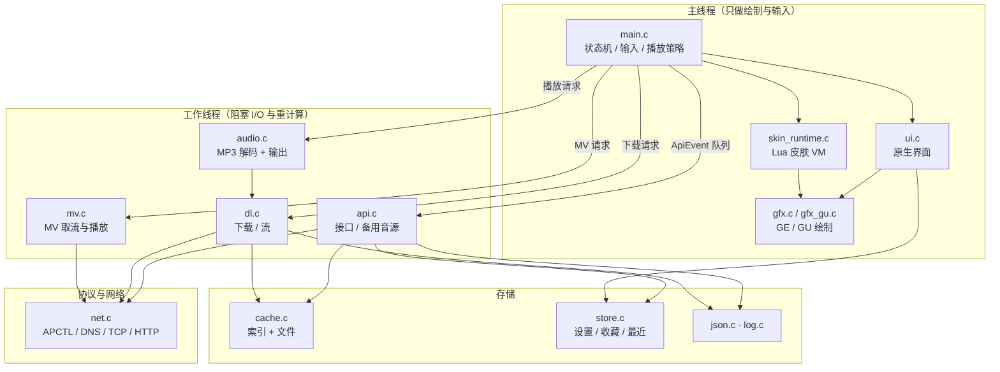
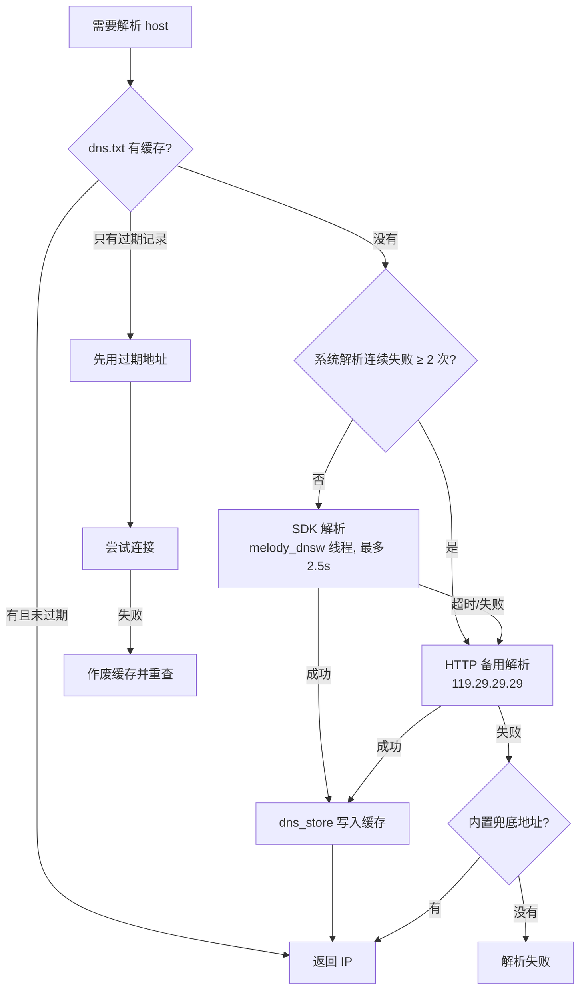

# 架构说明

本文描述 MELODY PSP 4.x 的运行形态、线程模型、模块分层与关键数据结构。
配合 [LOGIC.md](LOGIC.md)（链路细节）与 [BUILD.md](BUILD.md)（构建）阅读。

---

## 1. 运行形态

PSP 上的自制程序有两种常见形态：直接 `EBOOT.PBP` 启动，或「小启动器 + 主程序 PRX」。
MELODY 用后者：

```
记忆棒根目录/PSP/GAME/MELODY/
├── EBOOT.PBP        小启动器（211KB，pspdev 生成，仅负责加载 melody.prx）
├── melody.prx       主程序（约 3.5MB，全部业务逻辑）
├── melody_mv565.prx 软件 MV 解码模块（四档画质各一个）
├── melody_mv_avc.prx 原生 AVC 模块（可选）
├── skins/           Lua 皮肤
├── update.txt       在线更新地址
├── cache/           缓存音频与封面（运行时生成）
└── log.txt          运行日志（运行时生成）
```

为什么要拆 PRX：主程序把 7MB 的 MV 堆腾出来给解码模块，同时让「程序更新」与
「解码模块更新」互相独立；启动器还能在更新安装阶段用自带的英文点阵显示进度，
避免主程序字体未加载时的额外内存开销。

**路径约定**：程序内所有路径都是 `./` 相对（`src/app.h` 的 `APP_DIR`），
启动器与主程序都先 `chdir` 到自己所在目录，并在每个工作线程启动时
`melody_bind_thread_directory()` 重新绑定当前目录——因为 PSP 的 cwd 是
**进程级**状态，任何线程 `chdir` 都会影响别人。

---

## 2. 线程模型

PSP 的 SPU 只有一个核（MIPS R4000 + Media Engine），所以「线程」主要是为了把
**阻塞 I/O** 挪出渲染循环，而不是并行计算。全部线程如下：

| 线程 | 入口 | 优先级 | 职责 |
|---|---|---|---|
| `melody_main` | `src/prx_entry.c` | 0x20 | 创建主线程并进入 `main()`（在 PRX 入口线程之外另起，避免模块启动栈限制） |
| 主循环 | `src/main.c` | 0x20 | 输入、状态机、事件派发、绘制、每帧 60fps |
| `melody_api` | `src/api.c` | 0x18 | 所有 HTTP 请求 + JSON 解析，结果转成 `ApiEvent` 投递 |
| `melody_dl` | `src/dl.c` | 0x19 | 分段下载队列 + 边下边播流；写盘与校验 |
| `melody_dec` | `src/audio.c` | 0x16 | MP3 解码，把 PCM 写进环形缓冲 |
| `melody_audio` | `src/audio.c` | 0x14 | 输出线程，按 44.1kHz 节奏喂 `sceAudioOutputBlocking` |
| `melody_dnsw` | `src/net.c` | 0x1c | 有界 DNS 解析 worker（见 §5.2） |
| `melody_cb` | `src/main.c` | 0x11 | 退出回调（`sceKernelRegisterExitCallback` 转发） |
| `mv_play` / `mv_dl` | `src/mv.c` | 0x17 / 0x18 | MV 播放与取流 |
| `mvsrc_dl` | `src/mvsrc.c` | — | 独立取流 worker（MV 快速起播路径） |
| `mv_export` | `src/mvexport.c` | 0x28 | MV 导出到记忆棒 |

约定：

- 主线程**永不**直接阻塞在网络或文件上（除了极短的 `sceIoOpen`）。
- API 线程通过无锁事件环形队列向主线程投递 `ApiEvent`（`kind/index/msg`），
  主循环每帧 `api_poll()` 取事件；事件带 `index` 与「请求代次」，旧请求的回应不会覆盖新状态。
- 下载线程与音频线程共享 `cache/<id>.mp3` 文件：下载线程负责「写」，解码线程负责「读」，
  两者用 `dl_stream_available(gen)` / `dl_stream_readable()` 的**可读前缀**协议同步，
  避免 PSP FAT 上「读方先打开空文件、写方 O_TRUNC 失败」的老问题。
- 所有跨线程共享状态要么在一个锁里（`dl_lock()`），要么用代次号（`generation`）做乐观校验。

---

## 3. 模块分层



| 文件 | 行数量级 | 职责要点 |
|---|---|---|
| `main.c` | ~4.2k | 屏幕枚举 `SC_*`、事件处理、播放上下文 `playback_context.h`、自动下一首、下载选择模式 |
| `ui.c` | ~3k | 原生页面绘制；设置项顺序由 `settings_order.h` 单一来源驱动 |
| `api.c` | ~5k | 每个接口一个 `job_*`，共用 `fetch()`；`alt.c` 负责取不到地址时换源 |
| `net.c` | ~2.1k | 连接状态机、DNS 缓存（`dns.txt`）、HTTP 头解析、gzip、取消 |
| `dl.c` | ~1.5k | 多连接分片、`.part` 检查点、可读前缀、队列持久化 |
| `audio.c` | ~1.5k | `sceMp3` 封装、环形缓冲、重采样、seek、解码异常恢复 |
| `mv.c` | ~1.8k | MV 选源、起播门槛（码率/缓冲）、AVC 与软件模块切换 |
| `skin_runtime.c` | ~250 | Lua VM 生命周期、页面索引到皮肤函数的映射 |
| `skin_catalog.c` | ~1k | 主题目录、安装/更新、失败重试与错误上报 |

---

## 4. 界面框架

- 屏幕状态机：`app.h` 的 `SC_*`（18 个屏幕），`set_screen()` 负责进场动画与返回栈。
- 绘制单位：`gfx_*`（565 色、320×240 或 480×272 由固件与设置决定），
  所有坐标写成逻辑像素，`gfx` 内部乘缩放；原生界面与皮肤共用同一套绘制原语。
- 渲染后端：`gfx_set_renderer()` 在 **GE**（`sceGe` 直接下发）与 **GU**（`sceGu` 状态机）
  之间切换，设置项里对应「渲染加速」；皮肤可以只画一个矩形，性能瓶颈主要在
  贴图上传与列表重绘，因此列表使用脏矩形 + 预乘渐变色块。
- 皮肤页面：`page` 是 `SC_*` 的稳定编号，`skin_runtime_draw(page, t, dt)` 把模型
  （`SongList`/`CardList`/播放状态）打包成 Lua 表再调用皮肤的 `draw(page, model)`；
  皮肤通过 `action` 字符串回传用户意图（如 `"play"`、`"open"`），由 `main.c` 统一执行。

---

## 5. 网络层

### 5.1 连接

`net_apctl_connect(profile, seconds)` 会先 `sceNetApctlConnect`，然后轮询到 `GOT_IP`。
PSP 的 `GOT_IP` **早于** DHCP 下发 DNS 服务器，所以还要用 `apctl_dns_ready()`
读 `PRIMDNS/SECDNS` 等到非零；否则第一次解析会阻塞十几秒。

### 5.2 DNS



三级策略（见 [LOGIC.md](LOGIC.md) §7）：

1. 本地 `dns.txt` 缓存（带 TTL，RTC 不可信时不过期）；
2. 系统解析器——放在 `melody_dnsw` 线程里执行，调用方最多等 2.5 秒；
3. 纯 HTTP 备用解析 `http://119.29.29.29/d?dn=…`（按 IP 直连，不需要域名解析）。

系统解析连续失败两次后，后续查询直接先走第 3 步，避免每首歌都白等 2.5 秒；
一旦系统解析成功一次即恢复原顺序。缓存里的地址连不上时，`tcp_connect()` 会作废它并重查一次。

### 5.3 HTTP

自带实现（非 libcurl）：连接复用（keep-alive）、`Range` 分段、`Content-Length` 校验、
gzip 解压、`Cookie` 持久化、超时与「取消」语义。PSP 网络栈没有 TLS，
所以全部接口必须是 `http://`。

---

## 6. 内存与静态预算

| 项 | 大小 | 说明 |
|---|---|---|
| `SongList` | `600 × sizeof(Song)` ≈ 260KB | 列表页一次性最多 600 首 |
| MV 堆 | 7MB | 软件解码模块的帧缓冲与参考帧，启动 MV 时临时申请 |
| 主程序堆 | 24MB 左右（按机型） | 图片、JSON 缓冲、皮肤 VM |
| 解码环形缓冲 | 256KB | 约 1.5 秒 128kbps 音频 |

原则：**能用静态数组就不用动态分配**；大对象（MV 帧、封面原图）按「用完立即释放」
管理；皮肤 VM 有独立内存上限，超限时回退到原生界面而不是崩溃。

---

## 7. 数据模型

`src/app.h` 是唯一的数据契约：

- `Song`：`id/name/artist/album/art/dur_ms/fee/pop/hot/playable/mv`
  （`playable=2` 表示网易无地址，`fee<0` 表示来自第三方音源，界面据此显示「三方」「酷我」）；
- `SongList`：定长数组 + `title/kind/chart_id`；
- `Card`/`CardList`：歌单、榜单、歌手卡片；
- `Comment`/`CommentList`、`Lyric`、`Chart`、`Profile`；
- `ApiEvent`：网络线程 → 主线程的唯一消息类型。

跨模块契约头文件（`dl_progress_contract.h`、`mv_settings_contract.h`、
`playback_context.h`、`settings_order.h`、`next_plan.h` 等）把「纯函数逻辑」
从带 PSP 依赖的实现里拆出来，宿主机测试直接编译这些头文件做断言，
这也是 `tests/` 大量用例能脱离 PSP 运行的原因。
