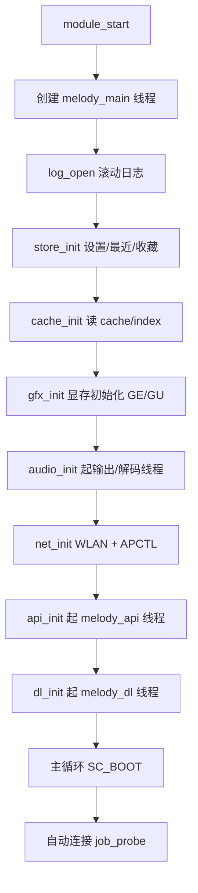
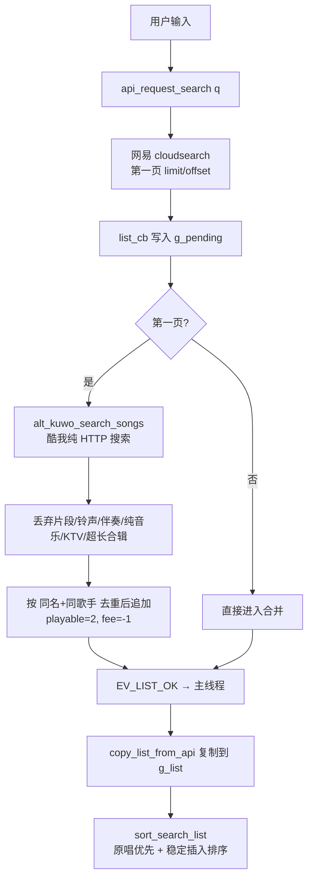
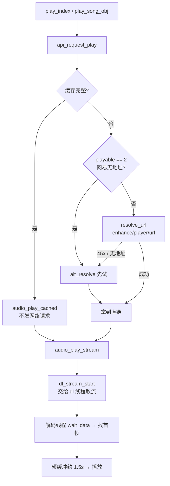
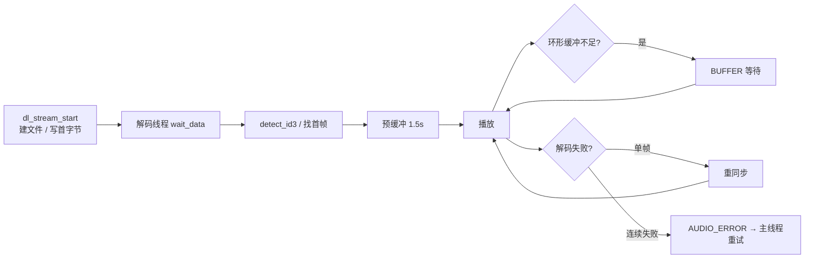
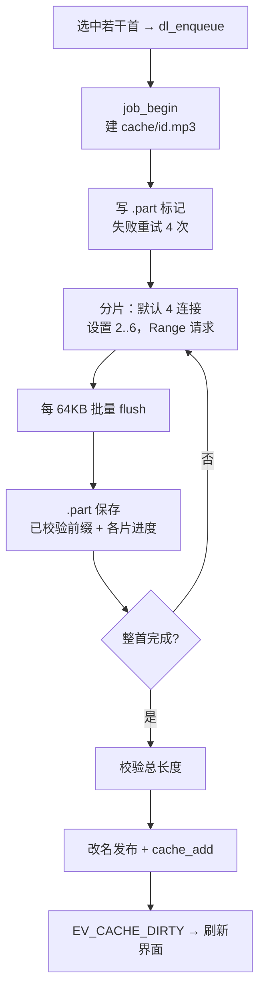
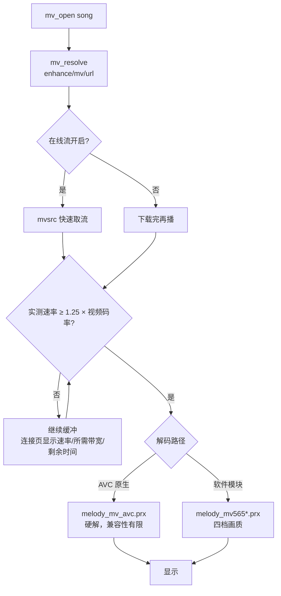
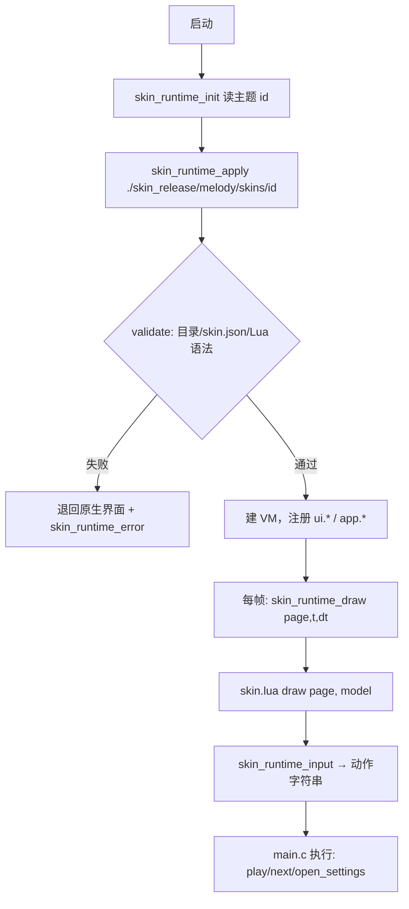
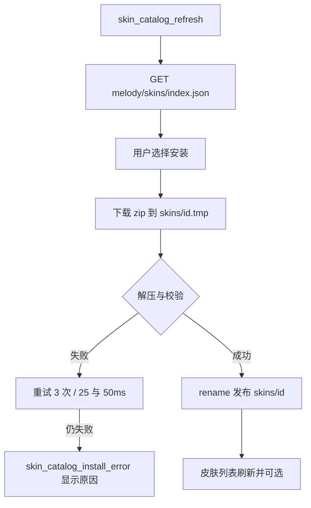
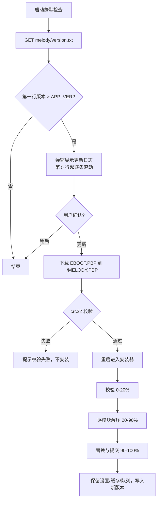
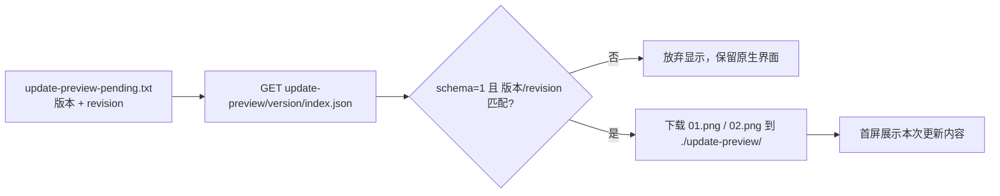

# 关键逻辑说明

本文按「用户做了什么 → 程序内部发生了什么」的方式描述主要链路。
涉及的文件都在 `src/` 下，函数名可直接搜索。

---

## 1. 启动与联网

启动顺序如上：**先本地状态，再显存，最后网络**。这样即使没插网卡/没配 WiFi，
程序也能进界面（设置、缓存、本地音乐都可用），不会卡在启动阶段。

自动连接（`job_probe` 链路）：

1. `net_last_profile()` 读上次成功的配置号，先试它；
2. 失败则遍历 `net_list_profiles()` 的**全部**已配置项（不写死 1..3）；
3. `net_apctl_connect()` 等 `GOT_IP`，再等 DNS 服务器下发（最多 6 秒）；
4. 用一次真实 HTTP 请求确认「能拿到 JSON」，而不是只看 TCP 三次握手成功；
5. 成功后写入 `profile号`，下次开机优先。

> 实测教训：只看 `GOT_IP` 会在 DHCP 还没下发 DNS 时开始解析，第一首歌因此白等 11～46 秒。

---

## 2. 搜索

排序（`main.c:song_score`）：

| 条件 | 分数变化 |
|---|---|
| 名称含翻唱/改版/伴奏/Live/演唱会/片段… | −150 |
| 歌手包含查询词（搜「周杰伦」时歌手是周杰伦） | +90 |
| 名称包含查询词 | +40 |
| 第三方音源行（确定能播） | +30 |
| 网易标记可播 | +10 |
| 底分 | 热度 `pop` |

稳定插入排序，分数先算一次存表，避免 O(n²) 里重复做字符串匹配。

---

## 3. 播放

`main.c` 里只有两条入口：`play_index()`（当前列表）与 `play_song_obj()`（任意一首）。
真正的取址在 API 线程：

取址细节（按优先级）：

1. 缓存命中（`cache_complete`）→ 直接 `audio_play_cached()`，不发网络请求；
2. `playable==2`（网易无地址）→ `alt_resolve()` 先试，失败再走官方接口；
3. `resolve_url(id)`：`/api/song/enhance/player/url`，默认 128k，历史失败会降级；
4. `alt_resolve()`：byfuns → 酷我 → 本地网关 → GDStudio（设置里可开关）；
5. 拿到 url 后 `audio_play_stream(song, url, total)`。

`audio_play_stream()` 之后：

事件：`EV_PLAY_OK`（起播成功）、`EV_PLAY_FAIL`（取址失败）。
主线程的重试策略：**只有真正播放满 2 秒才算起播成功**，否则最多重试 2 次
（每次间隔 1.5 秒），仍失败则暂停并提示「按○重试」，不会无限循环重试。

自动下一首：`AUDIO_END` 且播放位置接近时长尾部 → `play_next(1)`；
播放模式（单曲/列表/随机）在 `next_plan.h` 里计算，预取队列按它生成。

---

## 4. 下载

三条重要规则：

1. **可读前缀**：`job_prefix()` 计算「从头开始连续写完」的字节数，
   边下边播只允许读这段，避免读到空洞。
2. **断点续传**：`.part` 记录每片偏移与前缀哈希；重连后从原偏移继续，
   不重下已校验部分。
3. **优先级**：MV 播放时 `dl_set_video_priority(1)` 让下载队列让路；
   更新安装期间只提高更新任务优先级，结束后恢复。

进度显示：百分比一律由**字节数**换算（`dl_progress_contract.h`），
不再用「已写块数 / 总块数」估算，避免出现 100% 却未完成。

---

## 5. MV

本地 MV：设置项「本地 MV 搜索」控制是否扫描 `ms0:/VIDEO`，默认关闭
（扫描大目录会明显拖慢启动）。

---

## 6. 皮肤

皮肤执行约定：

- `draw(page, m)` 每帧调用，`m` 是宿主打包的数据表（页面、播放状态、列表窗口等）；
- `input(page, pressed, held, dt)` 返回动作字符串，主程序统一执行，皮肤不直接改状态；
- VM 有固定内存与「字符串工作量」预算，超限回退原生界面而不是崩溃；
- 危险全局函数（`dofile`/`load`/`pcall`/`setmetatable`）在初始化时被移除。

皮肤安装（设置 → 主题 → 在线主题）：

主题页会在列表项下方直接显示失败原因，而不是只弹一个「安装失败」。

---

## 7. 在线更新

更新图库（更新后首次启动的展示页）：

---

## 8. 设置与状态存储

- `store.c`：`settings.txt`（25 个开关，顺序由 `settings_order.h` 统一）、
  `recent.txt`、`fav.txt`、`cache/index`、`alt.txt`（备用音源）、`dns.txt`（DNS 缓存）。
- 写入策略：先写 `.tmp` 再 `rename` 发布，掉电不会留下半截文件。
- 设置项顺序是「单一来源」：`settings_order.h` 的数组同时驱动界面顺序、
  上下键移动与 `MELODY_SETTINGS_COUNT`，测试会断言三者一致。

---

## 9. 诊断

- `log.txt`：滚动日志（超过上限从头覆盖），关键节点都带毫秒时间戳；
  网络、DNS、下载、解码、皮肤、更新各有前缀（`net dns`、`dl queue`、`audio`、`skin io`、`update`）。
- 设置 → 关于 → 日志：可直接查看/导出，方便群里反馈。
- 日志里常见可读信号：
  - `dns http ok <host>`：系统 DNS 失败，走了 HTTP 备用解析；
  - `audio error, retry N: <原因>`：解码/取流失败；
  - `dl stream: begin failed … err=…`：下载流没起来，err 是具体原因。
