# 界面截图

截图均为 480×272 的 PSP 屏幕实拍（PPSSPP 回放 + 真机对照），未做后期放大。
原生界面与主题皮肤是两套绘制路径，因此这里分两部分展示。

---

## 原生界面

  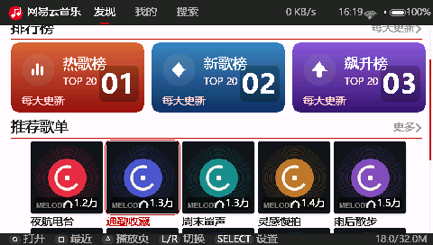

<em>首页：排行榜磁贴 + 推荐歌单，顶栏显示网速、时间与电量</em>

  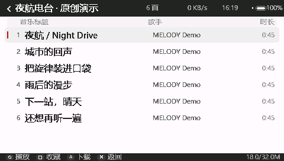

<em>歌曲列表：专辑/歌手/时长，底部是当前页可用按键</em>

  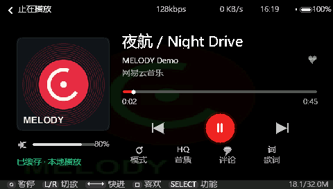

<em>播放页：唱片 / 封面、进度条、模式 / 音质 / 评论 / 歌词入口</em>

  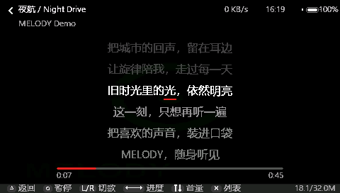

<em>歌词页：逐行滚动，支持翻译行与左右快进快退</em>

  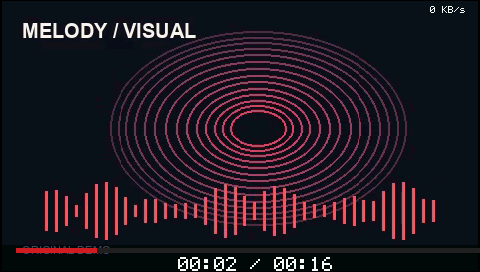
  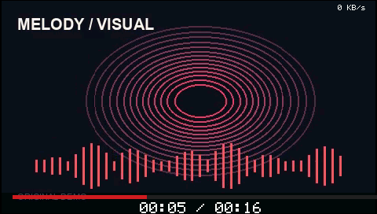

<em>MV：软件解码 / 原生 AVC 两种路径，起播前会实测带宽</em>

  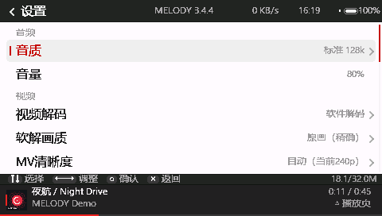

<em>设置：25 个选项，顺序由 <code>settings_order.h</code> 统一</em>

  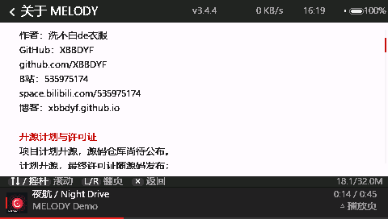

<em>关于：版本、作者、第三方组件与许可证</em>

---

## 主题皮肤

皮肤是 Lua 脚本画出来的，所以同一台机器可以完全不同的样子。
下面是仓库里 9 套内置皮肤的主题预览（`skin_release/melody/skins/<id>/preview.png`）：

  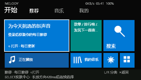
  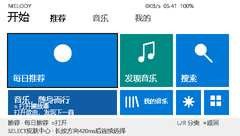

<em>Metro（深色 / 浅色）：Windows Phone 风格磁贴，可在主题里即时换色</em>

  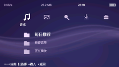
  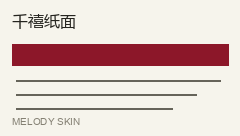

<em>XMB：PSP 系统菜单风格；Paper：浅色纸质排版</em>

  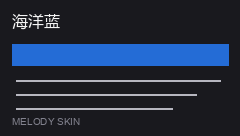
  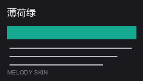
  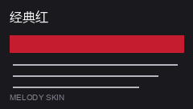
  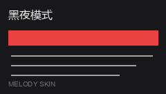
  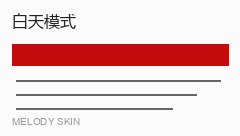

<em>Ocean / Mint / Ruby / Night / Daylight：配色变体</em>

---

## 更新开场展示图

每次版本更新后，首次启动会展示两张 480×272 的更新说明图（由
[`tools/make_update_splash.py`](../tools/make_update_splash.py) 生成）：

  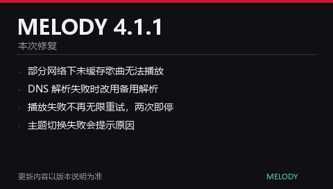
  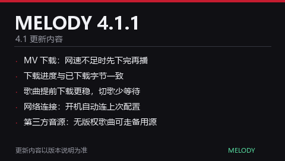

<em>4.1.1：左页是本次修复，右页是 4.1 的更新内容（修复写在最上面）</em>

生成规则：图库 `index.json` 里的 `version` 与 `revision`（= 安装包的 bundle CRC）
必须与本次发布一致，应用才会在更新后显示这两张图。

---

## 自己截图

- **真机**：PSP 没有系统级截图，通常用 PPSSPP 回放同一画面代替，或用采集卡；
- **PPSSPP**：`F12` 截图，输出在 PPSSPP 的 `PSP/SCREENSHOT` 目录；
- 截图请保持 480×272 原始尺寸，不要放大或加滤镜，方便和别人的画面直接对照。
