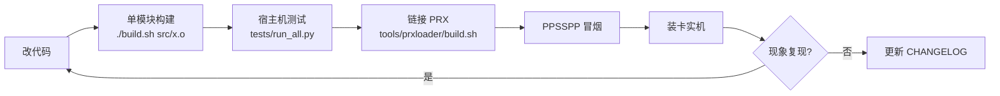

# 工作流程

这份文档描述 MELODY 从「改一行代码」到「群友装上并反馈」的完整流程。
目的很实际：这个项目踩过的坑大多不是「不会写」，而是「没按顺序验证」——
比如只在 PPSSPP 里跑过就宣称真机可用，或者改了皮肤忘了同步模板。

---

## 0. 版本号规则

| 位置 | 例子 | 含义 |
|---|---|---|
| 主版本 `X` | 4.x | 架构或大规模 UI 变化 |
| 次版本 `Y` | 4.1 | 一批新功能（如皮肤系统） |
| 修订 `Z` | 4.1.1 | 只修 bug，不加功能 |

版本号只有一个来源：`src/app.h` 的 `APP_VER`。
`make` 时由它决定「设置 → 关于」与日志首行；打包脚本会断言它与发布目录名一致。
改版本号必须同时改三处测试里的断言（`test_disc_setting` / `test_renderer_setting` /
`test_relative_app_paths`），否则 CI 式的全量测试会红。

---

## 1. 开发循环



具体命令：

```bash
# 1) 只编改动模块（比 make 快很多）
./build.sh src/main.o src/ui.o

# 2) 宿主机回归（125 个自包含用例）
python -B tests/run_all.py

# 3) 链接主程序 + 启动器
./tools/prxloader/build.sh

# 4) PPSSPP 冒烟：日志首行应打印新版本与编译时间
#    把完整安装目录放进带 portable.txt 的 PPSSPP 目录即可

# 5) 装卡：只替换 melody.prx（皮肤一起改时再替换 skin.lua）
```

### 验证分级（必须分开写）

| 级别 | 能证明什么 | 不能证明什么 |
|---|---|---|
| 宿主机测试 | 纯逻辑、时序、协议契约 | 任何 PSP 运行时行为 |
| PPSSPP | 界面流程、下载/播放器路径 | 真机 WLAN、UMDFAT、Media Engine |
| 物理 PSP | 最终结论（含卡顿、温度、断流） | — |

提交说明里要写清「在哪一级验证过」，**不要**把模拟器结论写成真机结论。

---

## 2. 修复类改动的固定动作

1. **先拿日志**：`ms0:/PSP/GAME/MELODY/log.txt`，找出能判定的量（毫秒、字节、错误码）；
2. **写下根因**：是超时、竞争、路径、还是权限？写不出来就先别改；
3. **加一条能失败的测试**：能写成宿主机用例的优先（`tests/`）；
4. **改实现**，跑全量测试；
5. **补日志**：失败分支必须有 `mlog()`，包含具体原因（下次别人不用再猜）；
6. 更新 `CHANGELOG.md` 与相关文档。

> 例：4.1.1 的「未缓存歌曲放不了」就是先看到 `dns done ms=2502 result=-1`
> 与缓存歌曲正常播放并存，才确定是运营商 DNS 解析不了 CDN 域名。

---

## 3. 打包

```bash
# 生成 releases/MELODY-<版本>/（完整安装 + 在线更新 + manifest + 版本说明）
python -B tools/prxloader/package_versioned_release.py 4.1.1

# 生成更新开场展示图（版本 + revision 与 manifest 对齐）
python -B tools/make_update_splash.py 4.1.1
```

产物结构：

```text
releases/MELODY-4.1.1/
├── 完整安装/PSP/GAME/MELODY/   小启动器 + melody.prx + MV 模块 + skins
├── 在线更新/EBOOT.PBP          启动器 + 压缩模块
├── 在线更新/version.txt        版本 / 地址 / 字节数 / crc32 / 更新日志
├── COS更新预览/update-preview/4.1.1/  01.png 02.png index.json
├── manifest.json               模块尺寸 + SHA256 + bundle CRC
└── 版本说明.txt
```

检查清单（每次打包都过一遍）：

- [ ] `version.txt` 第 1/3/4 行与 PBP 实际字节数、crc32 一致
- [ ] `manifest.json` 的模块 SHA256 与文件一致
- [ ] 更新图库 `index.json` 的 `version`、`revision`（= `bundle_crc32`）正确
- [ ] `一键替换` 包 `install.ps1 -VerifyOnly` 全部通过
- [ ] PPSSPP 启动日志首行版本号正确

---

## 4. 发布到交流群

**安装包只走 QQ 群（1103558445）群文件，不发 GitHub Releases。**


上传顺序（COS）不能反：

1. `EBOOT.PBP`（覆盖 `melody/EBOOT.PBP`）
2. `version.txt`（覆盖 `melody/version.txt`）
3. `update-preview/<版本>/`（三件：`01.png` `02.png` `index.json`）
4. 皮肤有改动才重传 `melody/skins/`

> 先传 PBP 后改 version.txt 的原因：应用是「读 version.txt → 下载新 PBP」，
> 中途用户检查更新会拿到新版本号却下到旧文件，校验失败。

---

## 5. 更新日志

两层记录，别混：

| 位置 | 面向 | 内容 |
|---|---|---|
| `在线更新/version.txt` 第 5 行起 | 用户（更新弹窗） | 短句、现象级描述 |
| `CHANGELOG.md` | 开发者 | 版本号 + 归类条目 + 备注 |

4.1.1 起采用分段写法：`【4.1.1 修复】` 在上，`【4.1 更新】` 在下——
用户先看到「这次修了什么」，再看到「上一版给了什么」。

---

## 6. 同步到开源仓库

开源仓库是**独立目录**：`E:\MELODY-PSP-OPENSOURCE\MELODY-PSP`，
本地 `git init` 的历史与线上一致，`origin` 指向 GitHub。

每次功能/修复定稿后：

```bash
# 1) 同步源码（只同步源文件，不拷 .o/.prx/发布产物）
robocopy E:\MELODY_MV_20261102\src E:\MELODY-PSP-OPENSOURCE\MELODY-PSP\src /E /XF *.o *.d

# 2) 同步皮肤 / 工具 / 测试（按需）
robocopy E:\MELODY_MV_20261102\skin_release\melody\skins E:\MELODY-PSP-OPENSOURCE\MELODY-PSP\skin_release\melody\skins /E
robocopy E:\MELODY_MV_20261102\tests E:\MELODY-PSP-OPENSOURCE\MELODY-PSP\tests /E /XF *.exe

# 3) 在开源目录里跑一遍测试，确认同步没漏文件
cd E:\MELODY-PSP-OPENSOURCE\MELODY-PSP
python -B tests/run_all.py

# 4) 更新 CHANGELOG / README / docs，提交并推送
git add -A
git -c user.name="XBBDYF" -c user.email="XBBDYF@users.noreply.github.com" \
    commit -m "修复：<现象>（根因 + 改动）"
git push
```

同步时**不要**带这些东西（`.gitignore` 已覆盖）：构建产物、`releases/`、`backups/`、
`.tmp/`、日志、缓存音频、记忆棒备份、账号 Cookie。

---

## 7. 备份与回滚

- 装卡前先备份：`melody.prx.bak-YYYYMMDD-HHMMSS`（脚本里已固化成习惯）；
- 皮肤同理：`skin.lua.bak-时间戳`；
- 发布包保留在 `releases/<版本>/`，出问题可直接回退上一版安装包；
- 仓库层面：删库重建前先 `git clone --mirror` 备份（本机有
  `_old-repo-backup.git` 的先例）。

---

## 8. 反馈闭环

群友反馈的标准动作：

1. 让 TA 发 `log.txt` + 机型 + 固件/自制系统 + 当前主题；
2. 在日志里找**可判定的量**（DNS 毫秒数、下载字节、重试次数、错误码）；
3. 能复现就先在 PPSSPP 复现；不能复现就根据日志加诊断输出，让下一份日志自己说话；
4. 修复后请对方复测，确认「现象消失」而不是「看起来好了」；
5. 把根因写进 `CHANGELOG.md` 与（必要时）`docs/LOGIC.md`，避免同一坑踩三次。
